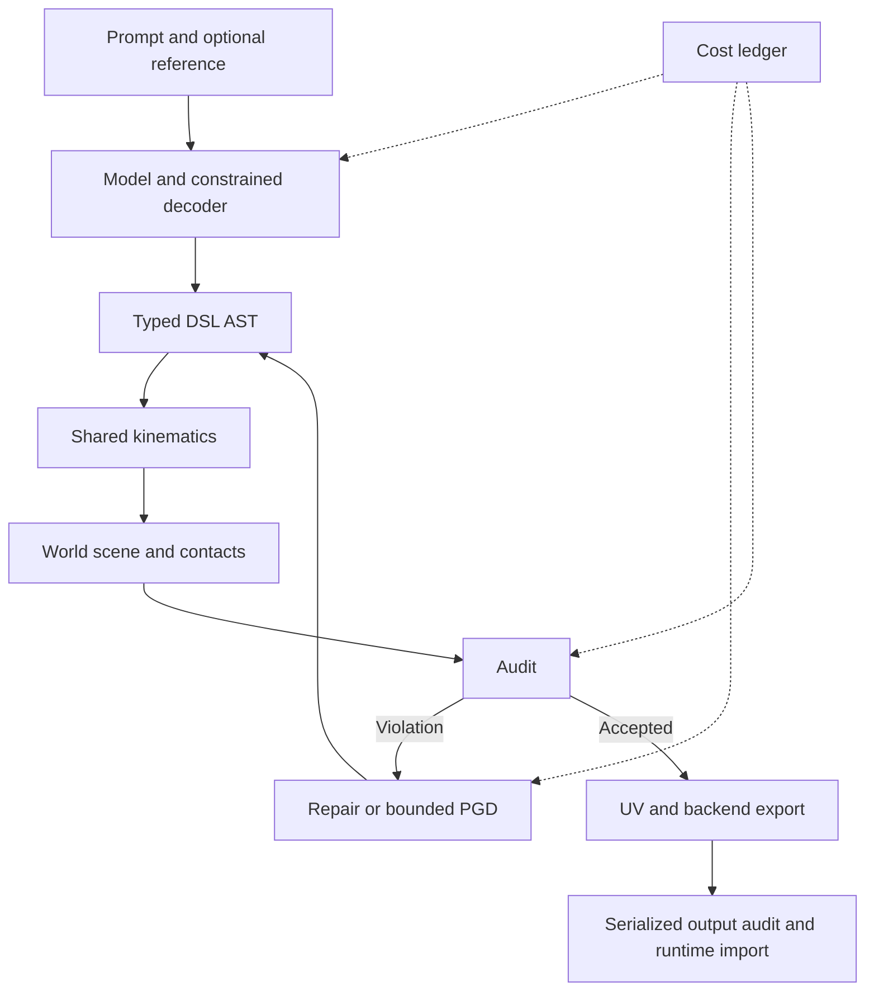

# SyncCraft architecture and implementation contracts

## Research destination

SyncCraft generates an editable structured program, then compiles and audits it.
The language model chooses topology, materials, sizes, and initial poses. The
deterministic compiler owns geometry and export. Continuous refinement is limited
to permitted pose variables. Model training must not substitute for a correct
compiler or trustworthy audit.

The report's main comparison is constrained generation plus compiler repair versus
classical projected optimization, with a learned refiner considered only after G2.

The starter implements `DSL -> AST -> NumPy kinematics -> limited audit -> atlas
and export`. The model, real decoder, differentiable projector, production audits,
and target-runtime stage are explicit next tasks.

## Layer contracts

| Layer | Input and output | Owner/invariant |
| --- | --- | --- |
| Parser | Text -> `Program` | No execution of generated code; typed fields and bounded parsing |
| Semantic validation | `Program` -> validated `Program` | Names, visibility, size, anchors, profile matrix |
| Geometry | `Program` -> `Scene` | Exact one convention for local/world frames and mirror expansion |
| Collision | Two OBBs -> signed minimum SAT depth and optional potential | Degenerate axes excluded; audit is distinct from smooth loss |
| Audit | `Scene` -> structured report | Each check and exclusion is visible; no unsupported acceptance claim |
| Atlas | `Program`, `Scene` -> descriptor and PNG | Integer per-face islands; deterministic layout and material colors |
| Export | `Scene`, atlas -> JSON object | World geometry preserved; source and target restrictions enforced |
| CLI | Input path + explicit target -> artifacts | Failed audit blocks default export; errors return nonzero |
| Evaluation | Raw events + fixed budgets -> results | No refund for discarded work; failures retained |

`Program` uses frozen dataclasses, with lists for declared items. Treat it as
immutable once shared; future caching should use a canonical serialization hash.
The public geometry compiler revalidates direct AST inputs. Exporters additionally
validate that a `Scene`'s local and world representations agree.

## Frames and quantities

Model units are the report's 16 units per nominal block. DSL Euler literals are
degrees; internal Torch optimizers will use radians at an explicit conversion
boundary. NumPy reference rotation is `Rz(z) @ Ry(y) @ Rx(x)` on column vectors.
Primitive extents are integer `size`; physical half extents add `inflate` separately.

The root has a world pivot. A child's joint lies at its parent-box anchor plus
the declared attachment offset in the parent bone frame. Its primary primitive's
center is displaced by the negative aligned half size in the child frame.
Subsequent primitives require `place`. See `GEOMETRY_CONVENTIONS.md` for equations.

Do not flatten a hierarchy by summing Euler angles. Compose matrices, then recover
the target representation. Do not serialize world pivots into every nested group
and then apply the ancestor transform again. The exporter tests reconstruct world
vertices to detect both errors.

## Production extensions

### PyTorch geometry and PGD

Reuse the same equations and semantic decisions as NumPy. Build tensorized
descriptors from the AST/expanded graph, not by independently interpreting text.
Cross-check forward values and finite-difference gradients. Integer dimensions,
topology, UV labels, and profile choices stay fixed. Freeze legacy Euler variables.
Constrain connected offsets and permitted rotations after every step. Track the
best audited feasible iterate; failed convergence remains a failure.

### Constrained decoder and rollback

Checkpoint token cursor, transformer cache, AST stack, symbol tables and prefix
tries, grammar state, geometry cache, PRNG state, and the retry/error context.
Restore all mutable generation state together; keep the cost ledger monotonic.
If error feedback changes the prefix, invalidate/recompute the affected KV suffix
rather than assuming a cache from the previous text remains valid. A token may
span several DSL terminals, so AST-close offsets require tokenizer alignment tests.

The report's maximum three retries is a starting policy. Distinguish attempts,
retries, complete compiler calls, initial audits, and the G2 three-re-audit limit.
They are not automatically interchangeable counters.

### Data and training

Generate original parameterized assets locally only after compiler/auditor labels
are reliable. Each row needs an asset ID, generator revision, family/body-plan ID,
parameters, canonical DSL/hash, prompt provenance, licenses, split, audit version,
audit output, target version, and optional rendered-view hashes. Use a pilot shard
first, then the report's scale targets. Freeze family-level heldouts before training.

Stage large shards on Colab local storage. The proposed trainer uses response-only
loss, verified chunked linear cross entropy, LoRA/QLoRA as appropriate, and full-state
checkpoints. The starter does not implement a GPU training loop. Checkpoint recovery
must prove optimizer/scheduler/RNG/data-cursor continuity, not just adapter loading.

### Learned refiner

The default is disabled. When G2 authorizes experiments, instantiate dimensions
from the selected model configuration. Recompute parameter counts rather than
assuming 3.98M for every base. The report's 3,977,252 number is conditional on its
stated layer shapes. Define behavior for all-masked history, invalid slots, mixed
precision, higher-order gradient flow, and truncated backpropagation explicitly.

### Animation and engine adapters

Keep static projection separate from motion generation. Recover the clipped grammar
before defining `spring_step`. IK fixtures must report stance masks, unreachable
targets, contact positions in world coordinates, and formula reconstruction error.
Bedrock and GeckoLib require independent versioned adapters and runtime tests;
shared concepts do not prove identical expression or state-container support.
