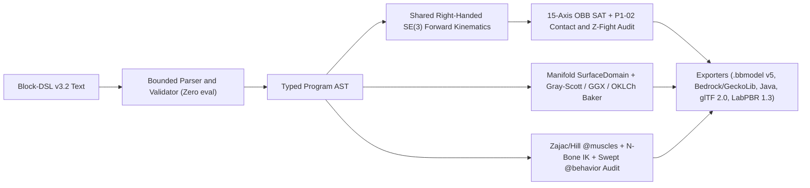
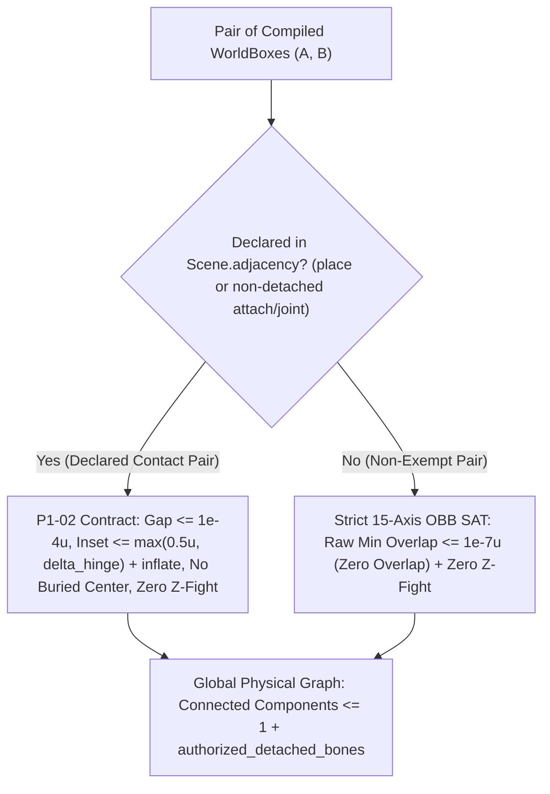

# Block-DSL v3.2 — Comprehensive Language Specification & External-AI Dataset Generation Guide

> [!NOTE]
> **Looking for Block-DSL v4.0 / v4.1 (`@layout`, `@component`, `@assembly`, `@morphology`, `gait`, `@stamps`, `edge`, `shade: banded`)?** See the canonical v4 specification at [BLOCK_DSL_V4_SPECIFICATION.md](BLOCK_DSL_V4_SPECIFICATION.md).

> [!IMPORTANT]
> **Purpose of This Document**: This is the self-contained, zero-ambiguity reference manual and dataset-engineering specification for **SyncCraft Block-DSL v3.2**. It is designed to be handed directly to an external AI model (or human technical artist) to synthesize **100% parser-valid, SE(3)-kinematics-valid, 15-axis SAT collision-free, `P1-02` physically connected, multi-material, animated 3D Minecraft / Blockbench assets** that fill underrepresented domains and biomechanical/procedural gaps in SyncCraft's human-artist training corpus (`TassP0lar/synccraft-v3-human-artist-dataset`), targeting our default multimodal world-model backbone **`LiquidAI/LFM3-VL-2B`**.

---

## Table of Contents

1. [Architectural Philosophy & Compilation Pipeline](#1-architectural-philosophy--compilation-pipeline)
2. [Lexical Rules, Limits & Complete Formal EBNF Grammar](#2-lexical-rules-limits--complete-formal-ebnf-grammar)
3. [Compile-Time Metaprogramming (`let`, `def`/`use`, `chain`) & Expanded Identifier Rules](#3-compile-time-metaprogramming-let-defuse-chain--expanded-identifier-rules)
4. [3D Coordinate Frame, SE(3) Kinematics & Flush-Contact Math](#4-3d-coordinate-frame-se3-kinematics--flush-contact-math)
5. [Section-by-Section Semantic Reference & Validation Bounds](#5-section-by-section-semantic-reference--validation-bounds)
6. [Physical Surface & Material System (`@palette`, `@materials`, `@style`)](#6-physical-surface--material-system-palette-materials-style)
7. [Musculoskeletal, Inverse Kinematics & Behavioral Animation (`@muscles`, `@kinematics`, `@behavior`, `@controller`)](#7-musculoskeletal-inverse-kinematics--behavioral-animation-muscles-kinematics-behavior-controller)
8. [Strict `P1-02` & Sculpted `ADR 0007` Contact / SAT Rules (Anti-Failure Guide)](#8-strict-p1-02--sculpted-adr-0007-contact--sat-rules-anti-failure-guide)
9. [Five Compiler-Verified End-to-End Golden Exemplars (Simple -> Colossal)](#9-five-compiler-verified-end-to-end-golden-exemplars-simple---colossal)
10. [Dataset Gap Analysis, 5 Assistant Supervision Modes & Copy-Paste External-AI Generation Kit](#10-dataset-gap-analysis-5-assistant-supervision-modes--copy-paste-external-ai-generation-kit)

---

## 1. Architectural Philosophy & Compilation Pipeline

SyncCraft builds a **rule-grounded constructive 3D world model** (`LiquidAI/LFM3-VL-2B`) for the Minecraft / Blockbench modeling, texturing, and animation pipeline — explicitly **not** a black-box mesh/image diffusion denoiser. Every asset is represented as a typed, human-readable **Block-DSL v3.2** program compiled deterministically without `eval()` or `exec()`:



### Core Invariants Every Generated Program Must Obey

1. **Zero Arbitrary Code Execution**: Block-DSL is parsed into frozen dataclasses (`Program`, `Meta`, `Palette`, `Bone`, `Box`, `Locator`, `MaterialDecl`, `StyleDecl`, `MuscleDecl`, `KinematicsDecl`, `BehaviorDecl`, `ControllerDecl`). Python syntax, `import`, loops, conditionals, or unknown fields fail immediately.
2. **Single Shared SE(3) Engine**: Rest compilation, posed animation frames, UV surface domain construction, SAT collision auditing, and all 5 backend exporters evaluate the exact same right-handed SE(3) kinematic chain.
3. **Discrete `size` vs. Continuous `inflate`**: Box `size` defines discrete integer (or `size_step`-quantized) nominal UV dimensions; `inflate` expands physical OBB half-extents $\mathbf{h} = \max(\mathbf{0}, \tfrac{1}{2}\mathbf{s} + \delta\mathbf{1}_3)$ without altering UV island dimensions.
4. **Explicit Physical Contact (`strict` vs. `sculpted`)**: Blanket sibling collision immunity is **forbidden**. Use default `audit_profile: strict` for flush mechanical/architectural assemblies (`<= 0.5u` inset), or explicit `audit_profile: sculpted` (`ADR 0007`) for sloped organic silhouettes, dragons, semi-curves, and chamfered/domed vehicles where tilted cuboids intentionally miter with bounded overlap (`<= 0.85 * t_med`), mandatory exterior protrusion (`0` swallowed boxes), `0` coplanar Z-fighting, and explicit `blend_with: [...]` seams.
5. **Explicit Rejection of Unimplemented Reserved Keywords**: `@shade`, `@ergonomics`, `@motion`, and `extrude` raise `UnsupportedFeature` (`DSLValidationError`). Never emit them.

---

## 2. Lexical Rules, Limits & Complete Formal EBNF Grammar

### 2.1 Lexical Conventions & Hard Compiler Budgets

| Rule / Budget | Exact Specification |
| :--- | :--- |
| **Encoding & File Size** | UTF-8 text, maximum **`2,000,000` bytes** (`2 MB`), maximum **`200,000` tokens**. |
| **Comments** | Both `// single-line` and `# single-line` comments are stripped anywhere whitespace is valid. Block comments (`/* ... */`) are **not** supported. |
| **Identifiers (`IDENT`)** | Regex `[A-Za-z_][A-Za-z0-9_]*` (ASCII letters, digits, underscores only; no hyphens, dots, spaces, or Unicode accents). |
| **Global Uniqueness** | Every declared **and** macro/mirror/radial/chain-expanded identifier across `@palette`, `bone`, `box`, `plane`, `locator`, `@muscles`, `ik_chain`, `look_chain`, `clip`, and `state` shares **one global symbol table** and must be unique (`<= 4,096` AST declarations; `<= 8,192` expanded mirror/radial nodes; maximum bone nesting depth `64`). (`@textures` names have their own uniqueness table.) |
| **Numbers (`NUMBER`)** | Signed or unsigned integer (`12`, `-4`), decimal (`0.25`, `-12.5`), or scientific notation (`1e-4`). Note: when `@meta.size_step == 1.0` (default), `box`/`plane` `size` literals **must be written as integers** (`[8, 4, 6]`, never `[8.0, 4.0, 6.0]`), and `@palette` `steps`, `@meta` `texel_density`, `radial` `count`, `chain` `segments`, and `@materials` `seed` must be integer-valued. |
| **Booleans (`BOOL`)** | Lowercase `true` or `false` only (`True`/`False` are invalid). |
| **Strings (`ESCAPED_STRING`)** | Double-quoted JSON strings (`"textures/entity/wyvern.png"`), used in `@textures` paths and optional quoted `@meta.dsl_version` / `audit_profile`. |
| **Arithmetic (`num_expr`)** | Supported everywhere a number is expected: `+`, `-`, `*`, `/` (division by zero rejected), unary `+`/`-`, parentheses `(...)` (max nesting `32`), and `let`-bound constants or `def` macro parameters. |

### 2.2 Top-Level Section Ordering

A valid Block-DSL v3.2 file consists of:
1. Optional `let` / `def` declarations (may also appear between top-level sections or `let` inside section/bone bodies).
2. **`@meta { ... }`** *(Required, first `@` section)*.
3. Optional `@textures { ... }` *(may appear before `@palette`, between `@palette` and `@rig`, or after `@rig`, at most once)*.
4. **`@palette { ... }`** *(Required, >= 1 ramp)*.
5. **`@rig { root bone <id> { ... } }`** *(Required, >= 1 `box` or `plane` across the rig)*.
6. Optional post-rig sections in **any order** (at most one of each):
   - `@textures { ... }` *(if not already declared earlier)*
   - `@materials { ... }`
   - `@style { ... }`
   - `@muscles { ... }`
   - `@kinematics { ... }`
   - `@behavior { ... }`
   - `@controller { ... }`

### 2.3 Formal Lark / EBNF Grammar (`src/synccraft/dsl/grammar.lark`)

```ebnf
start: preamble_decl* meta_section preamble_decl* textures_section? preamble_decl* palette_section preamble_decl* textures_section? preamble_decl* rig_section post_section* preamble_decl*

preamble_decl: let_decl | macro_def
let_decl: "let" IDENT "=" num_expr ";"?
macro_def: "def" IDENT "(" macro_params? ")" "{" bone_body_or_wrapped "}"
macro_params: macro_param ("," macro_param)*
macro_param: IDENT ("=" num_expr)?
bone_body_or_wrapped: "bone" IDENT "{" child_bone_interior "}" | child_bone_interior

meta_section: "@meta" "{" meta_field ("," meta_field)* ","? "}"
meta_field: IDENT ":" (IDENT | NUMBER | ESCAPED_STRING)

textures_section: "@textures" "{" texture_entry+ "}"
texture_entry: IDENT ":" "image" "(" ESCAPED_STRING "," num_expr "," num_expr ")" ","?

palette_section: "@palette" "{" (let_decl | palette_entry)+ "}"
palette_entry: IDENT ":" "ramp" "(" "base_lch" "=" vec3 "," "steps" "=" num_expr ("," "hue_shift" "=" vec2)? ("," "emissive" "=" BOOL)? ")"

rig_section: "@rig" "{" preamble_decl* root_bone preamble_decl* "}"
root_bone: "root" "bone" IDENT "{" preamble_decl* ("pivot_local" ":" vec3)? rig_item* "}"
child_bone: "bone" IDENT attach_or_joint symmetry_mod* "{" child_bone_interior "}"
child_bone_interior: preamble_decl* ("rest_euler" ":" vec3)? ("joint_limits" ":" joint_limits)? rig_item*
symmetry_mod: "mirror_x" "(" IDENT ")"
            | "mirror" "(" mirror_args? ")"
            | "radial" "(" radial_args ")"
mirror_args: mirror_arg ("," mirror_arg)*
mirror_arg: "axis" "=" IDENT | ("as" | "name") "=" IDENT | IDENT
radial_args: radial_arg ("," radial_arg)*
radial_arg: ("count" | "axis") "=" (IDENT | num_expr)

rig_item: let_decl | box_decl | plane_decl | locator_decl | child_bone | use_macro | chain_decl
use_macro: "use" IDENT "(" macro_call_args? ")" "as" IDENT attach_or_joint symmetry_mod*
macro_call_args: macro_call_arg ("," macro_call_arg)*
macro_call_arg: IDENT "=" num_expr | num_expr

chain_decl: "chain" IDENT chain_header_item* "{" chain_body "}"
chain_header_item: attach_or_joint | symmetry_mod | "segments" ("=" | ":") num_expr ","? | "taper" ("=" | ":") num_expr ","?
chain_body: chain_prop* (let_decl | box_decl | plane_decl | locator_decl)+
chain_prop: "let" IDENT "=" num_expr ";"?
          | "axis" ":" ("+" | "-")? IDENT ","?
          | "rest_euler" ":" vec3 ","?
          | "joint_limits" ":" joint_limits ","?

attach_or_joint: attach | joint
attach: "attach" "(" "parent_box" "=" IDENT "," "anchor" "=" vec3 "," "align" "=" vec3 ("," "offset" "=" vec3)? ("," "detached" "=" BOOL)? ")"
joint: "joint" "(" "parent" "=" IDENT ("," "at" "=" vec3)? ("," "align" "=" vec3)? ("," "detached" "=" BOOL)? ")"
place: "place" "(" ("base_box" "=" IDENT ",")? "anchor" "=" vec3 "," "align" "=" vec3 ("," "offset" "=" vec3)? ")"

box_decl: "box" IDENT place? "{" elem_fields "}"
plane_decl: "plane" IDENT place? "{" elem_fields "}"
elem_fields: elem_field ("," elem_field)* ","?
elem_field: "size" ":" (vec2 | vec3)
          | ("material" | "mat") ":" IDENT
          | "inflate" ":" num_expr
          | "cullface" ":" ident_list
          | "blend_with" ":" ident_list
          | "rotate" ":" vec3
          | "pivot" ":" vec3
          | ("normal" | "plane_normal") ":" IDENT
          | "uv" ":" ("box" "(" num_expr "," num_expr ")" | vec2)
          | "uv_faces" ":" "{" uv_face_entry ("," uv_face_entry)* ","? "}"
          | "texture" ":" IDENT
          | "place" ":" place
uv_face_entry: IDENT ":" "[" num_expr "," num_expr "," num_expr "," num_expr ("," num_expr)? "]"

locator_decl: "locator" IDENT "{" "offset" ":" vec3 ("," "role" ":" IDENT)? "}"

post_section: textures_section | materials_section | style_section | muscles_section | kinematics_section | behavior_section | controller_section

materials_section: "@materials" "{" (let_decl | material_decl)+ "}"
material_decl: IDENT ":" "process" "(" "family" "=" IDENT ("," IDENT "=" (num_expr | IDENT))* ")"

style_section: "@style" "{" "target_encoding" ":" IDENT ("," IDENT ":" (BOOL | num_expr))* "}"

muscles_section: "@muscles" "{" (let_decl | muscle_decl)+ "}"
muscle_decl: "muscle" IDENT "{" "origin_bone" ":" IDENT "," "insertion_bone" ":" IDENT "," "action_axis" ":" IDENT "," "moment_arm_deg" ":" num_expr ("," muscle_opt)* "}"
muscle_opt: "tendon_coupling" ":" "[" IDENT "," IDENT "," num_expr "]"
          | "belly_box" ":" IDENT
          | "bulge_inflate" ":" num_expr

kinematics_section: "@kinematics" "{" (let_decl | ik_chain_decl | look_chain_decl | spring_decl)+ "}"
ik_chain_decl: "ik_chain" IDENT "{" ik_field ("," ik_field)* "}"
ik_field: "upper" ":" IDENT | "lower" ":" IDENT | "bones" ":" ident_list | "effector" ":" vec3 | "hinge_axis" ":" IDENT | "pole" ":" vec3
look_chain_decl: "look_chain" IDENT "{" "bones" ":" ident_list ("," "weight_decay" ":" num_expr)? "}"
spring_decl: "spring" IDENT "{" (spring_field (","? spring_field)*)? "}"
spring_field: ("stiffness" | "damping") ":" num_expr

behavior_section: "@behavior" "{" (let_decl | clip_decl | state_decl | spring_decl)+ "}"
clip_decl: "clip" IDENT "{" "duration_s" ":" num_expr ("," "loop" ":" BOOL)? (track_decl | keyframe_decl | muscle_drive_decl | ik_drive_decl)+ "}"
track_decl: "track" IDENT ":" IDENT "(" "axis" "=" IDENT "," "amp_deg" "=" num_expr "," "freq_hz" "=" num_expr ("," IDENT "=" num_expr)* ")"
keyframe_decl: "key" IDENT "." IDENT "{" (key_entry ","?)+ (IDENT ","?)? "}"
key_entry: num_expr ":" vec3
muscle_drive_decl: "muscle_drive" IDENT ":" "activation" "(" "peak" "=" num_expr "," "freq_hz" "=" num_expr ("," IDENT "=" num_expr)* ")"
ik_drive_decl: "ik_drive" IDENT ":" "foot_cycle" "(" "stride" "=" num_expr "," "lift" "=" num_expr ("," "phase_deg" "=" num_expr)? ")"

state_decl: "state" IDENT "{" (pose_bias_decl | muscle_tone_decl | material_mod_decl)+ "}"
pose_bias_decl: "pose_bias" IDENT ":" vec3
muscle_tone_decl: "muscle_tone" IDENT ":" num_expr
material_mod_decl: "material_mod" IDENT ":" "{" "emissive" ":" num_expr "," "moisture" ":" num_expr "," "wear_delta" ":" num_expr "}"

controller_section: "@controller" "{" ("initial" ":" IDENT ","?)? controller_rule+ "}"
controller_rule: IDENT "->" IDENT "when" IDENT CMP_OP num_expr (","? "blend" (":" | "=")? num_expr)? ","? ";"?

ident_list: "[" IDENT ("," IDENT)* "]"
joint_limits: "[" vec2 "," vec2 "," vec2 "]"
vec2: "[" num_expr "," num_expr "]"
vec3: "[" num_expr "," num_expr "," num_expr "]"
CMP_OP: ">=" | "<=" | "==" | "!=" | ">" | "<"
```

---

## 3. Compile-Time Metaprogramming (`let`, `def`/`use`, `chain`) & Expanded Identifier Rules

> [!WARNING]
> **CRITICAL FOR `@muscles`, `@kinematics`, AND `@behavior` REFERENCES**: When a bone uses `mirror_x`, `mirror`, `radial`, `use`, or `chain`, SyncCraft deterministically expands the hierarchy into concrete bone and box names. Any `@muscles`, `@kinematics`, or `@behavior` reference to a generated bone or box **must use its exact expanded identifier** listed below!

### 3.1 Exact Expanded Identifier Naming Table

| Construct | Example Declaration | Expanded Root Bone Name(s) | Expanded Descendant Bone / Box / Locator Name(s) |
| :--- | :--- | :--- | :--- |
| **`mirror_x(twin)`** | `bone thigh_l attach(...) mirror_x(thigh_r) { box femur_l {...} bone shin_l attach(...) { box tibia_l {...} } }` | `thigh_l`, **`thigh_r`** | Left: `femur_l`, `shin_l`, `tibia_l`<br/>Right (**double underscore `__`**): **`thigh_r__femur_l`**, **`thigh_r__shin_l`**, **`thigh_r__tibia_l`** |
| **`mirror(axis=z)`** *(default name)* | `bone bogie_f attach(...) mirror(axis=z) { box axle {...} }` | `bogie_f`, **`bogie_f_mirror`** | `axle`, **`bogie_f_mirror__axle`** |
| **`mirror(axis=z, as=bogie_r)`** | `bone bogie_f attach(...) mirror(axis=z, as=bogie_r) { box axle {...} }` | `bogie_f`, **`bogie_r`** | `axle`, **`bogie_r__axle`** |
| **`radial(count=4, axis=z)`** | `bone vane joint(...) radial(count=4, axis=z) { box blade {...} }` | `vane`, **`vane_r1`**, **`vane_r2`**, **`vane_r3`** (`k = 1 .. count-1`) | `blade`, **`vane_r1__blade`**, **`vane_r2__blade`**, **`vane_r3__blade`** |
| **`def` + `use ... as <prefix>`** | `def pod(w=2) { box shell {...} bone fin attach(...) { box tip {...} } }`<br/>`use pod(w=3) as left_pod attach(...)` | **`left_pod`** *(macro root takes `<prefix>`)* | Single underscore `_`: **`left_pod_shell`**, **`left_pod_fin`**, **`left_pod_tip`** |
| **`use` + `mirror_x` / `radial`** | `use pod(w=3) as pod_l attach(...) mirror_x(pod_r)` | `pod_l`, **`pod_r`** | `pod_l_shell`, **`pod_r__pod_l_shell`** (`use` prefixes with `_` first, then `mirror`/`radial` prefixes with `__`) |
| **`chain <name> ... segments=3`** | `chain tail_spine attach(...) segments=3 taper=0.8 { axis: -z, box seg {...} }` | **`tail_spine_1`** -> **`tail_spine_2`** -> **`tail_spine_3`** (`1`-indexed nested serial chain) | Single underscore `_`: **`tail_spine_1_seg`**, **`tail_spine_2_seg`**, **`tail_spine_3_seg`** |

### 3.2 `let`, `def`/`use`, and `chain` Semantics

- **`let <name> = <num_expr>`**: Evaluates immediately to a finite `int` or `float`. Scoped lexically inside `bone` or `chain` bodies (restored on `}`).
- **`def <macro>(p1, p2=default) { ... }`**: Captures lexical `let` bindings at definition site; maximum recursion/nesting depth is `8` (direct self-recursion is disallowed). Positional arguments must precede keyword arguments in `use <macro>(...) as <prefix> <attach_or_joint> <symmetry_mod>*`.
- **`chain <name> [attach|joint] [symmetry_mod*] segments=K [taper=T] { [axis: +|-x|y|z,] [rest_euler: [...],] [joint_limits: [...],] <boxes/planes/locators> }`**:
  - `segments` $\in [1, 32]$ (integer); `taper` $\in [0.2, 2.0]$ (float, default `1.0`).
  - Segment `s` (`s = 1 .. K`, with `idx = s - 1`) scales template box sizes by $\text{taper}^{\text{idx}}$ rounded to the nearest positive multiple of `@meta.size_step` (minimum 1 step).
  - If `axis:` is omitted, the chain steps automatically in the direction opposite `attach.align` (`step_anchor = -attach.align`, `step_align = +attach.align`) when `attach.align` is a cardinal unit vector; otherwise defaults to `-z`.

---

## 4. 3D Coordinate Frame, SE(3) Kinematics & Flush-Contact Math

### 4.1 Right-Handed Coordinate Axes & Face Normals

SyncCraft uses a **right-handed Y-up column-vector frame** (`16` model units = `1` Minecraft block at `texel_density: 16`):

| Axis / Direction | Positive (`+1`) | Negative (`-1`) | Minecraft Face Name (`+1` / `-1`) | Canonical Entity Orientation |
| :--- | :--- | :--- | :--- | :--- |
| **X axis** | Right / East (`+X`) | Left / West (`-X`) | `east` (`+X`) / `west` (`-X`) | Entity's **left** side is **`-X`** or **`+X`** consistently (conventionally `-X` = character right or left as paired by `mirror_x`, `+Z` = front/snout) |
| **Y axis** | Up (`+Y`) | Down (`-Y`) | `up` (`+Y`) / `down` (`-Y`) | Ground plane is **`Y = 0`**; build upward in `+Y` so feet touch `Y = 0`! |
| **Z axis** | Front / South (`+Z`) | Back / North (`-Z`) | `south` (`+Z`) / `north` (`-Z`) | **`+Z`** = forward / snout / front face; **`-Z`** = backward / tail / rear |

### 4.2 Exact Intrinsic XYZ Rotation Matrix

All Euler angles in Block-DSL (`rest_euler`, `rotate`, `pose_bias`, `key ... .rotation`) are in **degrees** and compose intrinsic X-then-Y-then-Z on column vectors ($\mathbf{R} = \mathbf{R}_z(\gamma)\mathbf{R}_y(\beta)\mathbf{R}_x(\alpha)$):

$$
\mathbf{R}_{\text{xyz}}(x^\circ, y^\circ, z^\circ) =
\begin{bmatrix} \cos z & -\sin z & 0 \\ \sin z & \cos z & 0 \\ 0 & 0 & 1 \end{bmatrix}
\begin{bmatrix} \cos y & 0 & \sin y \\ 0 & 1 & 0 \\ -\sin y & 0 & \cos y \end{bmatrix}
\begin{bmatrix} 1 & 0 & 0 \\ 0 & \cos x & -\sin x \\ 0 & \sin x & \cos x \end{bmatrix}
$$

- **Pitch (`X`)**: $+x^\circ$ pitches `+Y` toward `+Z` (`+Z` snout pitches **down**, `-Z` tail pitches **up**). $-x^\circ$ pitches `+Z` snout **up**.
- **Yaw (`Y`)**: $+y^\circ$ turns `+Z` toward `+X`.
- **Roll (`Z`)**: $+z^\circ$ rolls `+X` toward `+Y`.

### 4.3 Exact Placement & Attachment Equations (`place`, `attach`, `joint`)

Every `anchor` and `align` component lies in `[-1, 1]` and indexes a normalized point inside a box's half-extents $\tfrac{1}{2}\mathbf{s}$:
- **`anchor`** selects the attachment point on the **reference (`base_box` / `parent_box`)** surface (`+1` = max face, `0` = center, `-1` = min face).
- **`align`** selects which face/point of the **new box (or child bone's primary box)** touches that reference point!

1. **Root Bone**:
   $$\mathbf{p}_{\text{world}}(\text{root}) = \text{pivot\_local}, \qquad \mathbf{R}_{\text{world}}(\text{root}) = \mathbf{I}_3$$
   Its first `box` without `place(...)` centers at bone-local $\mathbf{c}_{\text{local}} = \mathbf{0}$ (so if root `box` has `size: [8, 4, 8]` and you want its bottom on `Y = 0`, set `pivot_local: [0, 2, 0]`!).

2. **Same-Bone Subsequent `box` / `plane` (`place(...)` is REQUIRED on 2nd+ elements in a bone)**:
   Given earlier same-bone `base_box` $B$ with local center $\mathbf{c}_B$, size $\mathbf{s}_B$, and local box rotation $\mathbf{R}_B$:
   $$\mathbf{r}_{\text{ref}} = \mathbf{c}_B + \mathbf{R}_B\left(\tfrac{1}{2}\mathbf{s}_B \odot \text{anchor}\right)$$
   $$\mathbf{c}_{\text{unrot}} = \mathbf{r}_{\text{ref}} - \tfrac{1}{2}\mathbf{s}_{\text{new}} \odot \text{align} + \text{offset}$$
   *(If `base_box` is omitted, `anchor` MUST be `[0, 0, 0]` and $\mathbf{r}_{\text{ref}} = \mathbf{0}$, i.e., the bone's pivot.)*

3. **Child Bone via `attach(...)` vs. `joint(...)`**:
   - **`attach(parent_box=B, anchor=a, align=g, offset=o, detached=d)`**:
     Places the child bone's pivot in the parent bone's frame at:
     $$\mathbf{t}_{\text{child}} = \mathbf{c}_B + \mathbf{R}_B\left(\tfrac{1}{2}\mathbf{s}_B \odot \mathbf{a}\right) + \mathbf{o}$$
     and automatically shifts the child bone's **first (`primary`) box** (when that box omits `place`) to:
     $$\mathbf{c}_{\text{local}}(\text{primary}) = -\tfrac{1}{2}\mathbf{s}_{\text{primary}} \odot \mathbf{g}$$
     so the child's `g`-face sits **exactly on the joint pivot**!
   - **`joint(parent=B, at=[dx, dy, dz], align=g, detached=d)`**:
     Shorthand equivalent to `Attach(parent_box=B, anchor=[0, 0, 0], align=g, offset=[dx, dy, dz], detached=d, joint_mode=True)` without the `[-0.5, 0.5]` `offset` cap on `at`. Useful when specifying explicit pivot coordinates relative to `B`'s center (e.g. `radial` hubs).

### 4.4 Golden Flush-Stacking Cheat Sheet (`0.0` Gap, `0.0` Overlap)

Notice the universal rule: **for flush face-to-face contact, `align = -anchor` on the contact normal axis!**

| Spatial Intent (New Relative to `B`) | `anchor` on `B` | `align` on New | Resulting Contact |
| :--- | :---: | :---: | :--- |
| **Stack directly ON TOP of `B` (`+Y`)** | `[0, 1, 0]` | `[0, -1, 0]` | New bottom (`-Y`) flush with `B` top (`+Y`) |
| **Hang directly BELOW `B` (`-Y`, e.g., leg/shin)** | `[0, -1, 0]` | `[0, 1, 0]` | New top (`+Y`) hinges at `B` bottom (`-Y`) |
| **Extend FORWARD from `B` (`+Z`, e.g., snout)** | `[0, 0, 1]` | `[0, 0, -1]` | New back (`-Z`) flush with `B` front (`+Z`) |
| **Extend BACKWARD from `B` (`-Z`, e.g., tail)** | `[0, 0, -1]` | `[0, 0, 1]` | New front (`+Z`) flush with `B` back (`-Z`) |
| **Attach to `-X` SHOULDER / SIDE of `B`** | `[-1, 0.7, 0]` | `[1, 0.6, 0]` | New `+X` inner face flush with `B` `-X` side, near shoulder top |
| **Attach to `+X` SIDE of `B`** | `[1, 0, 0]` | `[-1, 0, 0]` | New `-X` inner face flush with `B` `+X` side |

### 4.5 Exact Symmetry Reflection Parity (`mirror_x` & `mirror(axis=x|z)`)

When a bone carries `mirror_x(twin_name)` (`S = diag(-1, 1, 1)`) or `mirror(axis=z, as=twin_name)` (`S = diag(1, 1, -1)`):
- All local translations, `anchor`, `align`, `offset`, and `locator` offsets multiply componentwise by $\mathbf{s} = (-1, 1, 1)$ (for X) or $(1, 1, -1)$ (for Z).
- All `rest_euler` and box `rotate` angles conjugate via $\mathbf{S}\mathbf{R}_{\text{xyz}}(x, y, z)\mathbf{S} = \mathbf{R}_{\text{xyz}}(s_y s_z x, s_x s_z y, s_x s_y z)$ so **every mirrored OBB retains $\det(\mathbf{R}) = +1$** (for `mirror_x`: `(rx, ry, rz) -> (rx, -ry, -rz)`; for `mirror(axis=z)`: `(rx, ry, rz) -> (-rx, -ry, rz)`).
- `joint_limits` intervals `[lo, hi]` automatically negate and swap (`[-hi, -lo]`) on axes whose angle sign flips.

---

## 5. Section-by-Section Semantic Reference & Validation Bounds

### 5.1 `@meta`

| Field | Required? | Type / Allowed Values | Default | Notes & Constraints |
| :--- | :---: | :--- | :---: | :--- |
| `archetype` | **Yes** | `entity`, `weapon_3d`, `block_multipart` *(Note: `item_extruded` is in enum for legacy parsing if box-only, but `entity` + `java_*` is **rejected**)* | — | Use `entity` for creatures/humanoids/vehicles with rigs; `block_multipart` for machines/buildings/furniture; `weapon_3d` for tools/weapons. |
| `target_profile` | **Yes** | `bedrock_entity`, `geckolib`, `bbmodel_5`, `java_modern`, `java_legacy` | — | **Animated `@behavior` clips require `bedrock_entity`, `geckolib`, or `bbmodel_5`!** (`java_modern` / `java_legacy` are static and enforce `[-16, 32]` world-corner bounds; `java_legacy` also restricts composed world rotations to single-axis `{-45, -22.5, 0, 22.5, 45}`). |
| `texel_density` | **Yes** | Positive `int` (`8`, `16`, `32`, `64`) | — | Standard Minecraft density is `16` (`1` model unit = `1` texel). |
| `dsl_version` | No | `"3.0"`, `"3.1"`, `"3.2"` | `"3.2"` | Omit when `"3.2"` (canonical formatter omits default). |
| `size_step` | No | `{1.0, 0.5, 0.25, 0.125, 0.0625, 0.03125, 0.1, 0.05, 0.01, 0.001}` | `1.0` | All non-zero `box`/`plane` `size` components must be exact positive multiples of `size_step`. When `1.0`, write integer literals! |
| `audit_profile` | No | `strict`, `sculpted`, `authored` | `strict` | Use default `strict` (omit field) for crisp flush fits (`<= 0.5u` inset, Gate `G2`). Set `audit_profile: sculpted` (`ADR 0007`) when constructing sloped snouts/bevels, `> 60°` horns, imbricated carapaces, or chamfered/domed vehicles (`<= 0.85 * t_med` overlap + exterior protrusion). **Never** emit `authored` (reserved strictly for decompiled human files). |

### 5.2 `@palette` & `@textures`

- **`@palette` entry**: `<mat_id>: ramp(base_lch=[L, C, H], steps=S, hue_shift=[h_shadow, h_light], emissive=bool)`
  - `L` $\in [0.0, 1.0]$ (OKLab perceptual lightness: `0.20` dark charcoal -> `0.88` bright snow/ivory).
  - `C` $\ge 0.0$ (OKLCh chroma: `0.00–0.04` neutral stone/metal, `0.06–0.14` natural wood/skin/leather, `0.15–0.25` vivid gems/enamel/plasma).
  - `H` $\in (-\infty, \infty)$ degrees (OKLCh hue angle: ~`25–45` red/rust, `55–85` gold/wood/amber, `135–165` moss/jade, `195–255` cyan/cobalt/steel, `280–330` violet/arcane).
  - `steps`: `int` in `[2, 256]` (typically `5` to `8`).
  - `hue_shift`: optional `[shadow_deg, highlight_deg]` (default `[0, 0]`, e.g., `[-6, 4]` cools shadows and warms highlights).
  - `emissive`: optional `bool` (default `false`).
- **`@textures` entry** *(optional; omit for self-contained procedural `@materials` assets)*:
  - `<tex_id>: image("<relative_path>", <width_int>, <height_int>)` (`width`, `height` > `0`).

### 5.3 `@rig`: `bone`, `box`, `plane`, `locator`

- **`root bone <id> { [pivot_local: [x, y, z]] <items...> }`**:
  - Must **not** have `attach`, `joint`, `mirror_x`, `mirror`, `radial`, `rest_euler`, or `joint_limits`.
- **Child `bone <id> <attach_or_joint> [symmetry_mod*] { [rest_euler: [rx, ry, rz]] [joint_limits: [[xmin, xmax], [ymin, ymax], [zmin, zmax]]] <items...> }`**:
  - `parent_box` / `parent` must name an **earlier** `box`, `plane`, or `locator` declared directly inside the **immediate parent bone** (if attaching to a `locator`, `anchor` must be `[0, 0, 0]`).
  - When `attach(...)` is used with `detached=false` (default), every component of `offset` must lie in **`[-0.5, 0.5]`**!
  - `joint_limits`: 3 pairs `[min_deg, max_deg]` satisfying **`-180 <= min_deg <= 0 <= max_deg <= 180`** (rest pose `0` must always lie inside the interval!).
  - Every `bone` must contain **at least one direct `box`, `plane`, or `locator`** (empty wrapper bones with only child bones are rejected in `strict` DSL; place at least a `locator` or structural `box` in every bone!).
- **`box <id> [place(...)] { size: [sx, sy, sz], material: <mat_id>, [inflate: d], [rotate: [rx, ry, rz]], [pivot: [px, py, pz]], [cullface: [...]], [blend_with: [...]], [uv: box(u, v)], [uv_faces: {...}], [texture: <tex_id>] }`**:
  - `material` (alias `mat`) must reference a declared `@palette` identifier.
  - `inflate`: finite float `>= 0.0` in `strict` and `sculpted` modes (e.g., `0.05`–`0.25` for armor trim/collars; negative `inflate` is rejected outside `authored`).
  - `cullface`: unique list from `{north, south, east, west, up, down}`.
  - `blend_with`: optional list of distinct expanded box/plane identifiers for explicit miter/slope seams under `audit_profile: sculpted` (for example, `blend_with: [prow_r__plate_l]` across a `mirror_x` centerline or `blend_with: [rib_r1__arch]` around a cyclic `radial(count=4)` dome).
- **`plane <id> [place(...)] { size: [w, h], normal: x|y|z, material: <mat_id>, ... }`**:
  - Zero-thickness 2D quad for wings, fins, capes, blades, petals, decals, and crests!
  - `size: [w, h]` gives the two positive tangential dimensions along the two axes other than `normal`:
    - `normal: x` -> expands to `3D size [0, w, h]` (`Y` width, `Z` height)
    - `normal: y` -> expands to `3D size [w, 0, h]` (`X` width, `Z` depth)
    - `normal: z` -> expands to `3D size [w, h, 0]` (`X` width, `Y` height)

> [!CAUTION]
> **Coplanar Z-Fighting Rule on `plane`**: Never place a zero-thickness `plane` with `inflate: 0` flat (`0°` angle, `0` normal offset) onto an unculled face of a solid `box`, or place two identical planes on the same world plane! `audit_scene` explicitly rejects `plane_on_box_face_coplanar` and `plane_plane_coplanar` Z-fighting. Instead, extend planes **outward** from an edge (e.g., wing membrane `anchor=[0, 0, -1], align=[0, 0, 1]` trailing behind a wing spar, dorsal fin `anchor=[0, 1, 0], align=[0, -1, 0]` standing upright on a skull/back, or tilt a cape by `rest_euler: [10, 0, 0]`).

- **`locator <id> { offset: [x, y, z], [role: <role>] }`**:
  - Dimensionless semantic 3D point in bone-local coordinates.
  - Allowed `role` values (`default: socket`): `socket`, `ik_effector`, `vfx_emitter`, `camera_focus`, `hitbox`, `rider_seat`.

---

## 6. Physical Surface & Material System (`@palette`, `@materials`, `@style`)

Instead of painting flat monochrome cubes or hallucinating noisy pixel grids, SyncCraft compiles textures from **3D manifold surface physics** (`SurfaceDomain` -> 3D Worley/fBm solid fields, Gray-Scott reaction-diffusion PDEs on welded cross-box seams, Airy thin-film interference, Archard contact wear, cavity AO, and Cook-Torrance GGX reflectance quantized to OKLCh ramps).

### 6.1 All 10 Material Families (`@materials`)

Syntax: `<palette_name>: process(family=<family>, key=value, ...)`

| `family` | Physical / Optical Mechanism | Ideal Part Use Cases | Recommended Key Parameters |
| :--- | :--- | :--- | :--- |
| **`brushed_metal`** | Conductive GGX microfacet + anisotropic brush tangent grooves + oxide patina | Blades, gears, armor plate, pistons, exhausts, anvil faces | `metalness=0.88..0.98`, `roughness=0.18..0.42`, `anisotropy=1.6..3.0`, `wear=0.2..0.5` |
| **`painted_metal`** | Dielectric clearcoat/enamel layer over metallic substrate; Archard edge chipping exposes bare metal | Industrial housings, vehicle hulls, painted mechs, safety trim | `roughness=0.25..0.45`, `metalness=0.15..0.35`, `coating=0.5..0.8`, `wear=0.3..0.6` |
| **`polymer_dielectric`** | Homogeneous Fresnel dielectric ($F_0$ from `ior`) + subtle mold/scuff roughness | Rubber tires/seals, lenses, visors, polymer grips, cables | `roughness=0.15..0.75`, `ior=1.45..1.65`, `metalness=0.0` |
| **`woven_fabric`** | Orthogonal warp/weft thread relief + asperity sheen + porosity | Capes, tabards, sails, saddles, banners, cloth wraps | `roughness=0.72..0.92`, `subsurface=0.15..0.35`, `porosity=0.3..0.6` |
| **`solid_wood`** | 3D coaxial growth-ring solid field + axial fiber anisotropy + pore darkening | Timber beams, weapon hafts, ship hulls, furniture, tree trunks | `roughness=0.58..0.78`, `anisotropy=1.8..2.8`, `scale=0.8..1.6` |
| **`weathered_stone`** | Multi-scale 3D Worley/fBm mineral clasts + porous cavity darkening + moisture/moss | Masonry, ruins, golems, horns, claws, boulders, plinths | `roughness=0.75..0.95`, `porosity=0.35..0.65`, `biofilm=0.1..0.45` |
| **`keratin_scales`** | Oriented imbricated 3D scale tiling + Gray-Scott reaction-diffusion pigmentation + dorsal-ventral shading | Dragons, wyverns, reptiles, fish, armored carapaces, talons | `roughness=0.28..0.50`, `coating=0.2..0.5`, `rd_feed=0.034..0.046`, `rd_kill=0.058..0.065` |
| **`patterned_skin`** | Manifold-continuous Gray-Scott Turing spots/stripes/rosettes + subsurface scattering | Mammals, amphibians, monsters, leather, organic membranes | `roughness=0.50..0.72`, `subsurface=0.25..0.55`, `rd_feed=0.030..0.055`, `rd_kill=0.057..0.064` |
| **`lichen_biofilm`** | Colony growth field favoring upward/occluded porous surfaces | Mossy roofs, ancient idols, swamp creatures, foliage, bark | `roughness=0.80..0.96`, `porosity=0.45..0.75`, `biofilm=0.55..0.95` |
| **`thin_film_iridescence`** | Exact Airy dielectric thin-film optical path interference (`film_nm`, `ior`) | Dragon wing membranes, beetle elytra, arcane crystals, energy cores | `roughness=0.08..0.22`, `ior=1.55..1.85`, `film_nm=320..580`, `emissive=0.0..0.8` |

### 6.2 Exact `@materials` Parameter Bounds & Defaults

| Parameter | Type | Default | Valid Range | Meaning |
| :--- | :---: | :---: | :--- | :--- |
| `roughness` | `float` | `0.35` | **`[0.02, 1.0]`** | Perceptual GGX microfacet roughness (`0.02` mirror -> `1.0` chalk) |
| `metalness` | `float` | `0.0` | **`[0.0, 1.0]`** | Conductor fraction (`0.0` dielectric, `1.0` pure metal) |
| `coating` | `float` | `0.0` | **`>= 0.0`** (`0..1`) | Clearcoat / enamel / wet mucus layer weight |
| `ior` | `float` | `1.5` | **`>= 1.0`** (`1.3..2.4`) | Dielectric index of refraction ($F_0 = ((n-1)/(n+1))^2$) |
| `scale` | `float` | `1.0` | **`> 0.0`** (`0.25..4.0`) | Spatial frequency multiplier for grain/scales/clasts |
| `seed` | `int` | `101` | finite `int` | Deterministic procedural RNG seed |
| `anisotropy` | `float` | `1.0` | **`> 0.0`** (`0.5..4.0`) | Axial brush/wood-grain stretch ratio |
| `subsurface` | `float` | `0.0` | **`[0.0, 1.0]`** | Translucent wrap/subsurface scatter weight |
| `porosity` | `float` | `0.08` | **`[0.0, 1.0]`** | Micro-pore moisture retention & cavity darkening |
| `emissive` | `float` | `0.0` | **`[0.0, 2.0]`** | Self-luminous radiance boost |
| `rd_feed` | `float` | `0.036` | **`[0.002, 0.2]`** | Gray-Scott feed rate $F$ (`0.030` spots, `0.038` stripes, `0.046` labyrinth) |
| `rd_kill` | `float` | `0.062` | **`[0.002, 0.2]`** | Gray-Scott kill rate $k$ (`0.057..0.065` structured Turing band) |
| `film_nm` | `float` | `380.0` | **`>= 0.0`** (`200..750`) | Thin-film thickness in nanometers (`320` violet/blue, `460` cyan/green, `580` gold/crimson) |
| `wear` | `float` | `0.35` | **`>= 0.0`** (`0..1`) | Edge/contact abrasion susceptibility |
| `oxidation` | `float` | `0.25` | **`>= 0.0`** (`0..1`) | Rust / verdigris / tarnish affinity |
| `biofilm` | `float` | `0.20` | **`>= 0.0`** (`0..1`) | Lichen / moss / algae colonization affinity |
| `weld_group` | `IDENT` | `none` | valid `IDENT` | Welds flush adjacent boxes sharing the same `material` and `weld_group` across seams so Turing patterns & wood/stone grain flow seamlessly across parts! |

### 6.3 `@style` Section

```dsl
@style { target_encoding: vanilla, quantize_ramp: true, bevel_highlight: 0.08, view_deg: 20 }
```
- `target_encoding` *(required)*: `vanilla` | `labpbr_1_3` | `gltf_2_0`
- `quantize_ramp` *(optional, default `true`)*: `true` | `false` (`true` snaps shaded pixels to crisp pixel-art OKLCh palette swatches; `false` retains smooth continuous PBR gradients).
- `bevel_highlight` *(optional, default `0.08`)*: `>= 0.0` (typically `0.05..0.15`, pixel-art edge bevel rim light).
- `view_deg` *(optional, default `20.0`)*: **`[0.0, 89.0]`** (reference off-normal viewing angle for baking specular/iridescence into static atlases).

> [!TIP]
> **Multi-Material Best Practice**: Always declare **3 to 6 distinct `@palette` + `@materials` slots** per asset (e.g., primary structural material, secondary trim/frame, organic/fabric accent, and emissive/optical detail) rather than painting an entire 25-box model with a single material!

---

## 7. Musculoskeletal, Inverse Kinematics & Behavioral Animation (`@muscles`, `@kinematics`, `@behavior`, `@controller`)

> [!IMPORTANT]
> **Why This Matters for Dataset Generation**: Real Blockbench/glTF files on the internet store only low-level FK bones and raw keyframes (`0` out of `2,606` crawled human assets contain `@muscles`, `@kinematics`, or `@controller`!). Generating rich, physically valid `@muscles` + `@kinematics` + `@behavior` + `@controller` programs is one of the highest-leverage contributions an external AI generator can make to SyncCraft's world model.

### 7.1 `@muscles` — Reduced-Order Zajac/Hill Biomechanics

Each `muscle` models an anatomical muscle-tendon unit spanning from `origin_bone` to `insertion_bone` (non-root, `origin_bone != insertion_bone`), solving normalized Zajac (1989) active Gaussian force-length $f_L(\tilde{L}) = \exp(-((\tilde{L}-1)/w)^2)$ + passive parallel-elastic $f_{PE}(\tilde{L}) = \max(0, \tilde{L}-1)^2$ torque equilibrium:

```dsl
@muscles {
  muscle pectoralis_l {
    origin_bone: chest,
    insertion_bone: wing_humerus_l,
    action_axis: z,
    moment_arm_deg: -42,
    tendon_coupling: [wing_forearm_l, z, -0.45],
    belly_box: keel_pectoral,
    bulge_inflate: 0.16
  }
}
```
- `action_axis`: `x` | `y` | `z`
- `moment_arm_deg`: **`[-90.0, 90.0]`** (signed lever arm in degrees; pair opposite-signed agonist/antagonist muscles on the same joint for natural co-contraction stiffness and bidirectional flapping/flexion!).
- `tendon_coupling` *(optional)*: `[<coupled_bone>, <axis>, <ratio>]` where `coupled_bone` is a distinct non-root bone (`!= insertion_bone`), `axis` $\in \{x, y, z\}$, and `ratio` $\in$ **`[-2.5, 2.5]`** (models avian/reptilian/mechanical pantograph linkages, e.g., flexing the humerus automatically folds/extends the forearm!).
- `belly_box` *(optional; **required if `bulge_inflate > 0`**)*: expanded `box` name that bulges isochorically via dynamic `inflate` when the muscle contracts while preserving integer Box-UV layout!
- `bulge_inflate` *(optional, default `0.0`)*: **`[0.0, 0.35]`**.

### 7.2 `@kinematics` — Limb IK, Distributed Gaze & Secondary Springs

Must contain at least one `ik_chain`, `look_chain`, or `spring`:
1. **`ik_chain <name> { ... }`**:
   - **2-bone shorthand**: `ik_chain leg_l { upper: thigh_l, lower: shin_l, effector: [0, -5.5, 0], hinge_axis: x }`
   - **Generalized N-bone (`2..16` bones)**: `ik_chain tentacle_a { bones: [seg_1, seg_2, seg_3, seg_4], effector: [0, 0, -4], hinge_axis: x, pole: [0, 1, 0] }`
   - **Crucial Parent-Child Rule**: Every bone in `bones` must be non-root, unique, and **`bones[i]` MUST be a direct child of `bones[i-1]`**! (Remember mirrored names: `bones: [thigh_r, thigh_r__shin_l]`!)
   - `effector`: 3D local offset on the terminal bone with norm `> 1e-4` (e.g., `[0, -6, 0]` at the bottom of a `6`-unit shin/foot).
   - `hinge_axis`: `x` | `y` | `z` (default `x`).
   - `pole` *(optional)*: nonzero 3D pole-target direction vector.
2. **`look_chain <name> { bones: [neck_1, neck_2, head], weight_decay: 0.7 }`**:
   - `bones`: `1..12` unique non-root bones; `weight_decay` $\in$ **`[0.05, 1.0]`** (default `0.75`).
3. **`spring <bone> { stiffness: 36, damping: 6.5 }`**:
   - Damped second-order inertial lag/follow-through on a non-root `bone` (`stiffness` $\in$ **`[0.1, 2000.0]`**, default `40.0`; `damping` $\in$ **`[0.0, 500.0]`**, default `6.0`). May appear in `@kinematics` or `@behavior`.

### 7.3 `@behavior` — Multi-Modal Motion Clips & Reactive States

Requires `target_profile` in `{bedrock_entity, geckolib, bbmodel_5}` whenever `clip` blocks are present.
- **`clip <name> { duration_s: <0.05..60.0> [, loop: true|false] <drives...> }`**:
  Must contain >= 1 drive from:
  1. **Analytic Harmonic / Impulse / Continuous `spin` `track`** *(non-root bone)*:
     `track <bone>: <law>(axis=x|y|z, amp_deg=<-120..120 or -1440..1440 for spin>, freq_hz=<(0, 20]>, phase_deg=<deg>, bias_deg=<-90..90>)`
     - `law` $\in$ **`{wave, flap, hinge, impulse, spin}`**:
       - `wave` = traveling sinusoid, `flap` = asymmetric upstroke/downstroke wingbeat, `hinge` = mechanical/unidirectional oscillation, `impulse` = sharp strike/recoil envelope (`|amp_deg| <= 120`).
       - **`spin`** = continuous linear mechanical rotation $\text{bias} + \text{amp\_deg} \cdot (t \cdot \text{freq\_hz} + \text{phase\_deg}/360)$ with **`|amp_deg| <= 1440`** for wheels, propellers, windmill rotors, `360°` turrets, and meshed gear ratios (e.g. `amp_deg=360` drive wheel paired with `amp_deg=-720` `2:-1` pinion gear).
     - **Loop Continuity Tip**: Choose `freq_hz` as an integer multiple of `1.0 / duration_s` (e.g. `duration_s: 2.0` -> `freq_hz=0.5` or `1.0`) so `loop: true` clips wrap seamlessly!
  2. **Explicit Spline `key`** *(any bone, including root for body bounce)*:
     `key <bone>.<rotation|position|scale> { t0: [x, y, z], t1: [x, y, z], ..., [linear|catmullrom] }`
     - Timestamps `t_i` must be non-decreasing in **`[0, duration_s]`**; `scale` components must be **`> 0`**.
     - Note: `key <bone>.rotation` specifies **additive pose Euler deltas** relative to `rest_euler`!
  3. **Biomechanical `muscle_drive`**:
     `muscle_drive <muscle_name>: activation(peak=<0..1>, freq_hz=<(0, 20]>, phase_deg=<deg>, baseline=<0..peak>)`
  4. **World-Anchored Stance `ik_drive`** *(guarantees `< 0.02u` foot slip during locomotion!)*:
     `ik_drive <ik_chain_name>: foot_cycle(stride=<0..24>, lift=<0..16>, phase_deg=<deg>)`
     - Pair left/right biped legs at `phase_deg=0` and `180`; quadruped diagonal gaits at `0, 180, 180, 0` or walk at `0, 90, 180, 270`! Keep `stride` realistic relative to leg length (typically `0.35x` to `0.6x` total leg length, e.g., `stride=4.5, lift=1.8` for a `10.5`-unit leg) so knees never hyperextend or collide with the torso!

- **`state <name> { ... }`** *(morphological + muscular + optical state modulation)*:
  - `pose_bias <non_root_bone>: [rx_deg, ry_deg, rz_deg]`
  - `muscle_tone <muscle_name>: <0.0..1.0>`
  - `material_mod <palette_name>: { emissive: <0..2>, moisture: <0..1>, wear_delta: <0..1> }` (all 3 fields required in that order).

### 7.4 `@controller` — Reactive State Machine

```dsl
@controller {
  initial: ground_stalk
  ground_stalk -> sky_soar when altitude > 2.5, blend 0.35
  sky_soar -> storm_enraged when threat_level >= 0.8, blend 0.2
}
```
- `initial` *(optional)* and every `from_state` / `to_state` must match a `clip` or `state` declared in `@behavior` (whenever `@behavior` declares clips/states).
- Comparison operators: `>`, `<`, `>=`, `<=`, `==`, `!=`. `blend` duration $\in$ **`[0.0, 10.0]`** seconds (default `0.2`).

---

## 8. Strict `P1-02` & Sculpted `ADR 0007` Contact / SAT Rules (Anti-Failure Guide)

Every generated program is audited by `audit_scene(scene, enforce_physical_contact=True)` and `audit_behavior_clip(program, clip_name)`. **Memorize these rules — they prevent 99% of synthetic generation failures:**



### The 7 Golden Anti-Failure Rules (WRONG vs. RIGHT)

1. **NO Unconnected Sibling Overlaps (`collision_pairs`)**:
   - *Trap*: Placing two boxes `horn_l` and `brow_plate` both via `place(base_box=cranium, ...)` at overlapping coordinates on `cranium`. Even though both touch `cranium`, `horn_l` and `brow_plate` have **no** `place` edge between each other, so ANY overlap `> 1e-7u` between them fails SAT!
   - *Fix*: Keep sibling boxes spatially separated (`anchor` X/Y/Z non-overlapping), OR chain `brow_plate` -> `horn_l` (`place(base_box=brow_plate, ...)`).

2. **NO Floating Parts (`separated_declared_contact`, gap `> 1e-4u`)**:
   - *Trap*: Writing `offset=[0, 0.5, 0]` on `place(base_box=plinth, anchor=[0, 1, 0], align=[0, -1, 0])` — this lifts the new box `0.5u` into midair! (Or rotating a `box` locally via `rotate: [15, 0, 0]` at the very corner of `base_box` without `pivot`, causing `cos(15°)` shrinkage to pull the face `0.1u` off `base_box`!)
   - *Fix*: Leave `offset=[0, 0, 0]` on flush contacts, and prefer **child `bone` with `rest_euler`** for angled horns, ears, wings, and limbs so rotation happens cleanly around the exact joint pivot! (If an element is intentionally hovering, e.g. a floating halo/drone orb, put it in a child `bone` with `detached=true`.)

3. **NO Deep Center Burial (`excessive_contact_penetration`)**:
   - *Trap*: Embedding a `[2, 2, 2]` rivet or eye box inside a `[8, 8, 8]` head with `anchor=[0, 0, 1], align=[0, 0, 1]` (which buries the entire `2u` depth inside the head, burying its center at `1.0u > 0.5u`!).
   - *Fix*: Mount surface details **outward** (`anchor=[0, 0, 1], align=[0, 0, -1]`) or inset by at most `-0.25u` (`offset=[0, 0, -0.25]`) so penetration stays `<= 0.5u` and the detail's center stays outside!

4. **Account for `inflate` on Neighboring Siblings**:
   - *Trap*: Adding `inflate: 0.25` to `pauldron_l` when `pauldron_l` sits `0.1u` away from `great_helm` (non-adjacent bone!). `inflate` expands physical SAT half-extents $\mathbf{h} = \tfrac{1}{2}\mathbf{s} + \text{inflate}$!
   - *Fix*: Declared contact pairs automatically allow `left.inflate + right.inflate`, **but non-exempt pairs must still clear each other's inflated OBBs**! Leave `>= inflate_A + inflate_B + 0.1u` clearance between non-adjacent armored parts.

5. **Square Hub Diagonal Clearance on `radial(count=K)`**:
   - *Trap*: Putting `radial(count=6, axis=z)` blades at radius `2.5` around a `4x4` square `hub_core` — at `60°`, the square hub's corner reaches $2\sqrt{2} \approx 2.828 > 2.5$, colliding with `vane_r1`!
   - *Fix*: Either use `radial(count=4, axis=z)` flush on the 4 cardinal faces `at=[0, 2, 0]` (`detached=false`, single connected component!), OR for `count >= 5` set `detached=true` at radius `> 0.5 * sqrt(w^2 + h^2) + 0.2` (and check chord spacing $2 R \sin(\pi / K) > \text{blade\_width}$).

6. **Swept Animation Clearance (`audit_behavior_clip`)**:
   - *Trap*: Hanging a rigid `tabard` box straight down from `cuirass` in front of `thigh_l`, then swinging `thigh_l` forward by `40°` in `walk` — frame 4 collides! Or forgetting bilateral sign on `mirror_x` wings: because `mirror_x` flips `ry` and `rz` signs (`angle_sign = [1, -1, -1]`), driving `wing_l` and `wing_r` symmetrically on `Z` via `track` uses **opposite** `amp_deg` signs (`amp_deg=30` on `wing_l`, `amp_deg=-30` on `wing_r`), whereas pitching legs in anti-phase walk on `X` (`angle_sign[0] = +1`) uses `phase_deg=0` vs `phase_deg=180` with the **same** `amp_deg`!

7. **Vanilla Java Profile Bounds (`java_modern` / `java_legacy`)**:
   - All box corners (including `inflate` and `rotate`) must lie inside **`[-16, 32]`** on X, Y, and Z! Center static Java block/multipart models around `[8, y, 8]` (standard `0..16` Minecraft block space) so they fit comfortably inside `[-16, 32]`.

### 8.1 Sculpted Partial-Overlap Contract (`audit_profile: sculpted`, `ADR 0007`)

When building **sloped organic silhouettes** (tapered dragon snouts, `> 60°` swept horns, curved armored carapaces, imbricated dorsal scales) or **chamfered/domed vehicles** (angled battleship prows, octagonal/domed castle bastions), set `audit_profile: sculpted` in `@meta`:
- **Permitted Miter & Joint Seams**: Bounded partial OBB overlap (`<= max(0.5u, delta_hinge(theta, 135°, 6.0u), 0.85 * t_med) + inflate_sum`) is allowed on declared contacts (`place`/`attach`/`joint`), same-bone tilted miter plates, parent-child joints, and explicit `blend_with: [...]` pairs (logged in `sculpted_overlap_pairs`).
- **Anti-Swallowing Protrusion Invariant (`swallowed_redundant_box`)**: Neither box may be 100% swallowed inside the other (`min_protrusion > min(0.25u, 0.15 * t_thin)` outside the partner's 8-corner OBB). Every cuboid must visibly contribute exterior surface silhouette!
- **Zero Z-Fighting & Zero Sibling-Bone Immunity**: Coplanar face Z-fighting (`z_fighting_pairs`), floating gaps (`> 1e-4u` at rest), and undeclared sibling-bone or non-adjacent limb-vs-body collisions (`thigh_l` vs `thigh_r`, `wing` vs `shoulder`, `gear` vs `wheel` across `360°` `spin` diagonal envelopes!) are still **strictly rejected**.

---

## 9. Five Compiler-Verified End-to-End Golden Exemplars (Simple -> Colossal)

All five exemplars below have been verified against `parse_program`, canonical round-trip `format_program`, `compile_geometry`, `audit_scene(enforce_physical_contact=True)` (`0` collisions, `0` contact violations, `0` Z-fighting), `compile_vanilla_atlas`, target exporters, and 12-frame swept `audit_behavior_clip` (`stance_slip < 0.02u`).

### 9.1 Tier 1 (`tier_1_simple`) — Static Prop / Block Multipart (`java_modern`)

```dsl
// Tier 1 (Simple Static Prop): Blacksmith Anvil & Timber Stand
@meta { archetype: block_multipart, target_profile: java_modern, texel_density: 16 }

@palette {
  granite_base: ramp(base_lch=[0.48, 0.03, 75], steps=6, hue_shift=[-4, 3])
  charred_oak: ramp(base_lch=[0.42, 0.08, 58], steps=6, hue_shift=[-6, 4])
  forged_iron: ramp(base_lch=[0.58, 0.02, 245], steps=8, hue_shift=[-3, 2])
  quench_brass: ramp(base_lch=[0.74, 0.13, 82], steps=6)
}

@rig {
  root bone anvil_station {
    pivot_local: [8, 2, 8]
    box plinth_slab { size: [12, 4, 10], material: granite_base, cullface: [down] }
    box oak_block place(base_box=plinth_slab, anchor=[0, 1, 0], align=[0, -1, 0]) {
      size: [8, 5, 6], material: charred_oak
    }
    box brass_collar place(base_box=oak_block, anchor=[0, 1, 0], align=[0, -1, 0]) {
      size: [6, 1, 5], material: quench_brass, inflate: 0.125
    }
    box anvil_waist place(base_box=brass_collar, anchor=[0, 1, 0], align=[0, -1, 0]) {
      size: [4, 3, 4], material: forged_iron
    }
    box anvil_face place(base_box=anvil_waist, anchor=[0, 1, 0], align=[0, -1, 0]) {
      size: [8, 3, 5], material: forged_iron
    }
    box anvil_horn place(base_box=anvil_face, anchor=[1, 0, 0], align=[-1, 0, 0]) {
      size: [4, 2, 3], material: forged_iron
    }
    box anvil_heel place(base_box=anvil_face, anchor=[-1, 0.2, 0], align=[1, 0, 0]) {
      size: [2, 2, 4], material: forged_iron
    }
  }
}

@materials {
  granite_base: process(family=weathered_stone, roughness=0.86, porosity=0.45, biofilm=0.18)
  charred_oak: process(family=solid_wood, roughness=0.68, anisotropy=2.2, wear=0.3)
  forged_iron: process(family=brushed_metal, roughness=0.28, metalness=0.92, wear=0.45, oxidation=0.18, weld_group=anvil_core)
  quench_brass: process(family=brushed_metal, roughness=0.24, metalness=0.88, oxidation=0.22)
}

@style { target_encoding: vanilla, bevel_highlight: 0.1, view_deg: 22 }
```

### 9.2 Tier 2 (`tier_2_medium`) — Parametric Industrial Mechanism (`let`, `def`/`use`, `radial`, `chain`, `labpbr_1_3`)

```dsl
// Tier 2 (Medium Parametric Industrial Mechanism): Radial Steam Turbine & Flue
let base_w = 12
let base_h = 3
let blade_span = 4

def rotor_vane(span=4, chord=2) {
  box vane_plate { size: [2, span, chord], material: brass_alloy }
  box vane_tip place(base_box=vane_plate, anchor=[0, 1, 0], align=[0, -1, 0]) {
    size: [2, 1, chord], material: safety_enamel
  }
}

@meta { archetype: block_multipart, target_profile: bbmodel_5, texel_density: 16 }

@palette {
  cast_housing: ramp(base_lch=[0.44, 0.04, 235], steps=6)
  safety_enamel: ramp(base_lch=[0.66, 0.16, 68], steps=6)
  brass_alloy: ramp(base_lch=[0.76, 0.12, 84], steps=8)
  rubber_seal: ramp(base_lch=[0.28, 0.02, 250], steps=5)
}

@rig {
  root bone turbine_skid {
    pivot_local: [0, 1.5, 0]
    box skid_bed { size: [base_w, base_h, 8], material: cast_housing }
    box pylon_riser place(base_box=skid_bed, anchor=[0, 1, 0], align=[0, -1, 0]) {
      size: [6, 5, 6], material: cast_housing
    }
    box stator_drum place(base_box=pylon_riser, anchor=[0, 1, 0], align=[0, -1, 0]) {
      size: [8, 8, 6], material: safety_enamel
    }
    locator steam_gauge { offset: [0, 14.5, 3.5], role: socket }

    bone rotor_shaft attach(parent_box=stator_drum, anchor=[0, 0, 1], align=[0, 0, -1]) {
      box shaft_collar { size: [3, 3, 2], material: rubber_seal }
      box hub_core place(base_box=shaft_collar, anchor=[0, 0, 1], align=[0, 0, -1]) {
        size: [4, 4, 3], material: brass_alloy
      }
      use rotor_vane(span=blade_span, chord=2) as vane joint(parent=hub_core, at=[0, 2, 0], align=[0, -1, 0]) radial(count=4, axis=z)
    }

    chain exhaust_pipe attach(parent_box=stator_drum, anchor=[0, 1, -0.3], align=[0, -1, 0]) segments=3 taper=0.8 {
      axis: +y,
      joint_limits: [[-18, 18], [-15, 15], [-18, 18]]
      box flue_ring { size: [4, 3, 4], material: cast_housing }
    }
  }
}

@materials {
  cast_housing: process(family=brushed_metal, roughness=0.46, metalness=0.85, wear=0.4, oxidation=0.3)
  safety_enamel: process(family=painted_metal, roughness=0.3, metalness=0.25, coating=0.65, wear=0.42)
  brass_alloy: process(family=brushed_metal, roughness=0.22, metalness=0.94, anisotropy=2.4, oxidation=0.15)
  rubber_seal: process(family=polymer_dielectric, roughness=0.72, ior=1.52, wear=0.2)
}

@style { target_encoding: labpbr_1_3, quantize_ramp: false, bevel_highlight: 0.12 }

@behavior {
  clip turbine_idle {
    duration_s: 2.0
    key rotor_shaft.rotation { 0: [0, 0, 0], 1.0: [0, 0, 180], 2.0: [0, 0, 360], linear }
    track exhaust_pipe_1: wave(axis=x, amp_deg=4, freq_hz=1.0)
    track exhaust_pipe_2: wave(axis=x, amp_deg=6, freq_hz=1.0, phase_deg=45)
    track exhaust_pipe_3: wave(axis=x, amp_deg=8, freq_hz=1.0, phase_deg=90)
  }
}
```

### 9.3 Tier 3 (`tier_3_complex`) — Articulated Humanoid Rig (`size_step: 0.5`, `plane`, `mirror_x`, `ik_chain`, `spring`)

```dsl
// Tier 3 (Complex Articulated Humanoid): Palatine Sentinel Knight
@meta { archetype: entity, target_profile: geckolib, texel_density: 16, size_step: 0.5 }

@palette {
  silver_plate: ramp(base_lch=[0.78, 0.03, 240], steps=8)
  royal_tabard: ramp(base_lch=[0.46, 0.16, 265], steps=6, hue_shift=[-5, 5])
  warm_leather: ramp(base_lch=[0.48, 0.09, 55], steps=6)
  aether_crest: ramp(base_lch=[0.74, 0.18, 195], steps=6, emissive=true)
}

@rig {
  root bone pelvis {
    pivot_local: [0, 12, 0]
    box hip_girdle { size: [6, 3, 4], material: warm_leather }

    bone torso attach(parent_box=hip_girdle, anchor=[0, 1, 0], align=[0, -1, 0]) {
      joint_limits: [[-20, 25], [-30, 30], [-15, 15]]
      box cuirass { size: [7, 7, 4.5], material: silver_plate, inflate: 0.15 }
      box chest_tabard place(base_box=cuirass, anchor=[0, 0.2, 1], align=[0, 0, -1]) {
        size: [4, 4.5, 0.5], material: royal_tabard
      }

      bone cape_mount attach(parent_box=cuirass, anchor=[0, 0.85, -1], align=[0, 1, 1]) {
        rest_euler: [10, 0, 0]
        joint_limits: [[-5, 55], [-15, 15], [-15, 15]]
        plane heraldic_cape { size: [6, 9], normal: z, material: royal_tabard }
      }

      bone head attach(parent_box=cuirass, anchor=[0, 1, 0], align=[0, -1, 0]) {
        joint_limits: [[-35, 35], [-55, 55], [-20, 20]]
        box great_helm { size: [5, 5.5, 5], material: silver_plate }
        plane plume_fin place(base_box=great_helm, anchor=[0, 1, 0], align=[0, -1, 0]) {
          size: [4.5, 3], normal: x, material: aether_crest
        }
        locator eye_focus { offset: [0, 2.5, 2.5], role: camera_focus }
      }

      bone arm_upper_l attach(parent_box=cuirass, anchor=[-1, 0.75, 0], align=[1, 0.6, 0]) mirror_x(arm_upper_r) {
        joint_limits: [[-75, 75], [-35, 35], [-45, 15]]
        box pauldron_l { size: [3, 5, 3], material: silver_plate, inflate: 0.1 }
        bone arm_lower_l attach(parent_box=pauldron_l, anchor=[0, -1, 0], align=[0, 1, 0]) {
          joint_limits: [[-85, 5], [-15, 15], [-10, 10]]
          box vambrace_l { size: [2.5, 4.5, 2.5], material: warm_leather }
          locator hand_socket_l { offset: [0, -4.5, 0.5], role: socket }
        }
      }
    }

    bone thigh_l attach(parent_box=hip_girdle, anchor=[-0.6, -1, 0], align=[0, 1, 0], offset=[-0.5, 0, 0]) mirror_x(thigh_r) {
      joint_limits: [[-65, 65], [-20, 20], [-20, 20]]
      box cuisse_l { size: [2.5, 5, 3], material: warm_leather }
      bone shin_l attach(parent_box=cuisse_l, anchor=[0, -1, 0], align=[0, 1, 0]) {
        joint_limits: [[-5, 85], [-10, 10], [-10, 10]]
        box greave_l { size: [2.5, 5.5, 3], material: silver_plate }
      }
    }
  }
}

@materials {
  silver_plate: process(family=brushed_metal, roughness=0.22, metalness=0.95, anisotropy=1.8, wear=0.28, weld_group=knight_armor)
  royal_tabard: process(family=woven_fabric, roughness=0.78, subsurface=0.18, porosity=0.35, wear=0.15)
  warm_leather: process(family=patterned_skin, roughness=0.62, coating=0.12, wear=0.32)
  aether_crest: process(family=thin_film_iridescence, roughness=0.14, ior=1.65, film_nm=430, emissive=0.55)
}

@style { target_encoding: vanilla, bevel_highlight: 0.09, view_deg: 20 }

@kinematics {
  ik_chain leg_ik_l { upper: thigh_l, lower: shin_l, effector: [0, -5.5, 0], hinge_axis: x }
  ik_chain leg_ik_r { upper: thigh_r, lower: thigh_r__shin_l, effector: [0, -5.5, 0], hinge_axis: x }
  look_chain sentinel_gaze { bones: [torso, head], weight_decay: 0.65 }
  spring cape_mount { stiffness: 36, damping: 6.5 }
}

@behavior {
  clip patrol_march {
    duration_s: 1.6
    ik_drive leg_ik_l: foot_cycle(stride=4.5, lift=1.8, phase_deg=0)
    ik_drive leg_ik_r: foot_cycle(stride=4.5, lift=1.8, phase_deg=180)
    track arm_upper_l: wave(axis=x, amp_deg=24, freq_hz=0.625, phase_deg=180)
    track arm_upper_r: wave(axis=x, amp_deg=24, freq_hz=0.625, phase_deg=0)
    key head.rotation { 0: [0, -8, 0], 0.8: [0, 8, 0], 1.6: [0, -8, 0], catmullrom }
  }
}
```

### 9.4 Tier 4 (`tier_4_masterwork`) — Apex Musculoskeletal Mythic Creature (`@muscles` + `@kinematics` + `@behavior` + `state` + `@controller`)

```dsl
// Tier 4 (Apex Musculoskeletal Creature): Astral Storm Wyvern
@meta { archetype: entity, target_profile: bedrock_entity, texel_density: 16 }

@palette {
  obsidian_scale: ramp(base_lch=[0.34, 0.06, 265], steps=8, hue_shift=[-6, 4])
  astral_membrane: ramp(base_lch=[0.64, 0.17, 215], steps=8, emissive=true)
  pale_sternum: ramp(base_lch=[0.74, 0.05, 82], steps=6)
  horn_ivory: ramp(base_lch=[0.82, 0.06, 78], steps=6)
}

@rig {
  root bone wyvern_pelvis {
    pivot_local: [0, 15, 0]
    box pelvis_core { size: [6, 5, 7], material: obsidian_scale }

    bone chest attach(parent_box=pelvis_core, anchor=[0, 0.2, 1], align=[0, 0, -1]) {
      joint_limits: [[-22, 22], [-20, 20], [-15, 15]]
      box ribcage { size: [8, 7, 9], material: obsidian_scale }
      box dorsal_crest place(base_box=ribcage, anchor=[0, 1, 0], align=[0, -1, 0]) {
        size: [2, 2, 5], material: horn_ivory, rotate: [6, 0, 0]
      }
      box keel_pectoral place(base_box=ribcage, anchor=[0, -1, 0.1], align=[0, 1, 0]) {
        size: [6, 2, 7], material: pale_sternum
      }
      locator saddle_anchor { offset: [0, 4, 4], role: rider_seat }

      bone neck_base attach(parent_box=ribcage, anchor=[0, 0.5, 1], align=[0, 0, -1]) {
        rest_euler: [-18, 0, 0]
        joint_limits: [[-35, 35], [-35, 35], [-20, 20]]
        box neck_seg { size: [4, 4, 6], material: obsidian_scale }

        bone skull attach(parent_box=neck_seg, anchor=[0, 0.2, 1], align=[0, 0, -1]) {
          rest_euler: [14, 0, 0]
          joint_limits: [[-30, 35], [-45, 45], [-20, 20]]
          box cranium { size: [5, 4, 6], material: obsidian_scale }
          box snout place(base_box=cranium, anchor=[0, -0.2, 1], align=[0, 0, -1]) {
            size: [3, 2, 5], material: obsidian_scale
          }
          locator breath_emitter { offset: [0, -0.5, 11], role: vfx_emitter }

          bone horn_l attach(parent_box=cranium, anchor=[-0.7, 1, -0.3], align=[0, -1, 1]) mirror_x(horn_r) {
            rest_euler: [26, -12, 0]
            box horn_spike_l { size: [1, 2, 5], material: horn_ivory }
          }

          bone jaw_lower attach(parent_box=cranium, anchor=[0, -1, 0.6], align=[0, 1, -1]) {
            joint_limits: [[-5, 42], [-8, 8], [-5, 5]]
            box mandible { size: [3, 1, 5], material: pale_sternum }
          }
        }
      }

      bone wing_humerus_l attach(parent_box=ribcage, anchor=[-1, 0.7, 0.2], align=[1, 0, 0]) mirror_x(wing_humerus_r) {
        joint_limits: [[-25, 25], [-30, 30], [-55, 60]]
        box wing_arm_l { size: [7, 2, 3], material: obsidian_scale }
        plane inner_patagium_l place(base_box=wing_arm_l, anchor=[0, 0, -1], align=[0, 0, 1]) {
          size: [6, 6], normal: y, material: astral_membrane
        }

        bone wing_forearm_l attach(parent_box=wing_arm_l, anchor=[-1, 0, 0], align=[1, 0, 0]) {
          joint_limits: [[-20, 20], [-35, 35], [-65, 45]]
          box wing_spar_l { size: [9, 2, 2], material: horn_ivory }
          plane outer_patagium_l place(base_box=wing_spar_l, anchor=[0, 0, -1], align=[0, 0, 1]) {
            size: [8, 8], normal: y, material: astral_membrane
          }
        }
      }
    }

    bone thigh_l attach(parent_box=pelvis_core, anchor=[-1, -0.3, 0], align=[1, 0.8, 0]) mirror_x(thigh_r) {
      rest_euler: [12, 0, 0]
      joint_limits: [[-55, 55], [-20, 20], [-20, 20]]
      box femur_l { size: [3, 6, 4], material: obsidian_scale }

      bone crus_l attach(parent_box=femur_l, anchor=[0, -1, 0], align=[0, 1, 0]) {
        rest_euler: [-18, 0, 0]
        joint_limits: [[-65, 45], [-15, 15], [-15, 15]]
        box tibia_l { size: [2, 6, 3], material: horn_ivory }
      }
    }

    chain tail_spine attach(parent_box=pelvis_core, anchor=[0, 0.2, -1], align=[0, 0, 1]) segments=4 taper=0.82 {
      axis: -z,
      joint_limits: [[-22, 22], [-28, 28], [-15, 15]]
      box caudal_vertebra { size: [4, 3, 5], material: obsidian_scale }
    }
  }
}

@materials {
  obsidian_scale: process(family=keratin_scales, roughness=0.34, coating=0.38, rd_feed=0.038, rd_kill=0.061, wear=0.25, weld_group=wyvern_hide)
  astral_membrane: process(family=thin_film_iridescence, roughness=0.18, ior=1.58, film_nm=460, subsurface=0.42, emissive=0.45)
  pale_sternum: process(family=keratin_scales, roughness=0.46, subsurface=0.2, wear=0.3)
  horn_ivory: process(family=weathered_stone, roughness=0.52, porosity=0.18, wear=0.4)
}

@style { target_encoding: gltf_2_0, quantize_ramp: false, bevel_highlight: 0.1 }

@muscles {
  muscle pectoralis_down_l {
    origin_bone: chest, insertion_bone: wing_humerus_l, action_axis: z, moment_arm_deg: -42,
    tendon_coupling: [wing_forearm_l, z, -0.45], belly_box: keel_pectoral, bulge_inflate: 0.16
  }
  muscle supracoracoideus_up_l {
    origin_bone: chest, insertion_bone: wing_humerus_l, action_axis: z, moment_arm_deg: 38,
    tendon_coupling: [wing_forearm_l, z, 0.35]
  }
  muscle pectoralis_down_r {
    origin_bone: chest, insertion_bone: wing_humerus_r, action_axis: z, moment_arm_deg: 42,
    tendon_coupling: [wing_humerus_r__wing_forearm_l, z, 0.45], belly_box: keel_pectoral, bulge_inflate: 0.16
  }
  muscle supracoracoideus_up_r {
    origin_bone: chest, insertion_bone: wing_humerus_r, action_axis: z, moment_arm_deg: -38,
    tendon_coupling: [wing_humerus_r__wing_forearm_l, z, -0.35]
  }
}

@kinematics {
  ik_chain hind_leg_l { bones: [thigh_l, crus_l], effector: [0, -6, 0.5], hinge_axis: x, pole: [0, 0, 1] }
  ik_chain hind_leg_r { bones: [thigh_r, thigh_r__crus_l], effector: [0, -6, 0.5], hinge_axis: x, pole: [0, 0, 1] }
  look_chain predator_track { bones: [chest, neck_base, skull], weight_decay: 0.7 }
  spring tail_spine_3 { stiffness: 32, damping: 5.5 }
  spring tail_spine_4 { stiffness: 24, damping: 4.5 }
}

@behavior {
  clip sky_soar {
    duration_s: 2.0
    muscle_drive pectoralis_down_l: activation(peak=0.88, freq_hz=0.5, phase_deg=0, baseline=0.08)
    muscle_drive pectoralis_down_r: activation(peak=0.88, freq_hz=0.5, phase_deg=0, baseline=0.08)
    muscle_drive supracoracoideus_up_l: activation(peak=0.75, freq_hz=0.5, phase_deg=180, baseline=0.05)
    muscle_drive supracoracoideus_up_r: activation(peak=0.75, freq_hz=0.5, phase_deg=180, baseline=0.05)
    track tail_spine_1: wave(axis=y, amp_deg=10, freq_hz=0.5, phase_deg=0)
    track tail_spine_2: wave(axis=y, amp_deg=14, freq_hz=0.5, phase_deg=45)
    key jaw_lower.rotation { 0: [0, 0, 0], 1.0: [18, 0, 0], 2.0: [0, 0, 0], catmullrom }
  }

  clip ground_stalk {
    duration_s: 1.6
    ik_drive hind_leg_l: foot_cycle(stride=5.0, lift=2.0, phase_deg=0)
    ik_drive hind_leg_r: foot_cycle(stride=5.0, lift=2.0, phase_deg=180)
    track wing_humerus_l: hinge(axis=z, amp_deg=6, freq_hz=0.625, bias_deg=22)
    track wing_humerus_r: hinge(axis=z, amp_deg=-6, freq_hz=0.625, bias_deg=-22)
    track tail_spine_1: wave(axis=y, amp_deg=12, freq_hz=0.625)
  }

  state storm_enraged {
    pose_bias jaw_lower: [28, 0, 0]
    muscle_tone pectoralis_down_l: 0.35
    muscle_tone pectoralis_down_r: 0.35
    material_mod astral_membrane: { emissive: 1.4, moisture: 0.35, wear_delta: 0.05 }
  }
}

@controller {
  initial: ground_stalk
  ground_stalk -> sky_soar when altitude > 2.5, blend 0.35
  sky_soar -> ground_stalk when altitude <= 0.5, blend 0.3
  sky_soar -> storm_enraged when threat_level >= 0.8, blend 0.2
}
```

### 9.5 Tier 4 Colossal Vehicle (`tier_4_masterwork`, `audit_profile: sculpted`) — Walking Citadel Fortress (`blend_with` Prow & Radial Dome + Continuous `spin` Drivetrain + 4-Leg `foot_cycle` IK)

```dsl
// Tier 4 (Colossal Sculpted Moving Castle Vehicle): Walking Steam Citadel
@meta { archetype: entity, target_profile: geckolib, texel_density: 16, audit_profile: sculpted }

@palette {
  ashlar_masonry: ramp(base_lch=[0.56, 0.03, 78], steps=8, hue_shift=[-3, 3])
  riveted_armor: ramp(base_lch=[0.42, 0.08, 245], steps=8, hue_shift=[-4, 4])
  forged_brass: ramp(base_lch=[0.72, 0.12, 82], steps=6)
  fortress_timber: ramp(base_lch=[0.50, 0.09, 58], steps=6)
  boiler_firebox: ramp(base_lch=[0.74, 0.21, 38], steps=6, emissive=true)
}

@rig {
  root bone chassis_hull {
    pivot_local: [0, 20, 0]
    box main_hull { size: [18, 8, 24], material: riveted_armor }
    box underbelly_keel place(base_box=main_hull, anchor=[0, -1, 0], align=[0, 0.45, 0]) {
      size: [12, 4, 20], material: riveted_armor, rotate: [12, 0, 0]
    }
    box boiler_core place(base_box=main_hull, anchor=[0, 0.1, -1], align=[0, 0, 0.8]) {
      size: [12, 7, 6], material: boiler_firebox
    }
    box timber_deck place(base_box=main_hull, anchor=[0, 1, 0], align=[0, -1, 0]) {
      size: [16, 2, 22], material: fortress_timber
    }
    locator helm_bridge_seat { offset: [0, 18, 6], role: rider_seat }

    bone prow_wing_l attach(parent_box=main_hull, anchor=[-0.55, 0, 1], align=[0, 0, -0.5]) mirror_x(prow_wing_r) {
      rest_euler: [0, 26, 0]
      joint_limits: [[-5, 5], [-5, 5], [-5, 5]]
      box prow_plate_l { size: [8, 7, 6], material: riveted_armor, blend_with: [prow_wing_r__prow_plate_l] }
      box ram_spur_l place(base_box=prow_plate_l, anchor=[0, -0.6, 1], align=[0, 0.3, -0.4]) {
        size: [4, 3, 4], material: forged_brass, rotate: [20, 0, 0], blend_with: [prow_wing_r__ram_spur_l]
      }
    }

    bone citadel_keep attach(parent_box=timber_deck, anchor=[0, 1, -0.18], align=[0, -1, 0]) {
      joint_limits: [[-4, 4], [-6, 6], [-4, 4]]
      box keep_walls { size: [14, 10, 14], material: ashlar_masonry }
      box buttress_fore place(base_box=keep_walls, anchor=[0, -0.1, 1], align=[0, 0, -0.5]) {
        size: [6, 7, 3], material: ashlar_masonry, rotate: [18, 0, 0]
      }
      box parapet_aft place(base_box=keep_walls, anchor=[0, 1, -0.85], align=[0, -1, 0]) {
        size: [6, 2, 2], material: ashlar_masonry
      }
      locator periscope_focus { offset: [0, 14, 7], role: camera_focus }

      bone corner_turret_fl attach(parent_box=keep_walls, anchor=[-0.85, 1, 0.85], align=[0, -1, 0]) mirror_x(corner_turret_fr) {
        joint_limits: [[-5, 5], [-5, 5], [-5, 5]]
        box watchtower_fl { size: [4, 6, 4], material: ashlar_masonry }
        box spire_roof_fl place(base_box=watchtower_fl, anchor=[0, 1, 0], align=[0, -0.6, 0]) {
          size: [3, 4, 3], material: riveted_armor, rotate: [0, 45, 0]
        }
      }

      bone bastion_drum attach(parent_box=keep_walls, anchor=[0, 1, 0], align=[0, -1, 0]) {
        joint_limits: [[-4, 4], [-180, 180], [-4, 4]]
        box drum_core { size: [6, 4, 6], material: ashlar_masonry }
        box cupola_pedestal place(base_box=drum_core, anchor=[0, 1, 0], align=[0, -1, 0]) {
          size: [3, 3, 3], material: ashlar_masonry
        }
        box cupola_crown place(base_box=cupola_pedestal, anchor=[0, 1, 0], align=[0, -1, 0]) {
          size: [4, 2, 4], material: forged_brass
        }

        bone dome_rib joint(parent=drum_core, at=[0, 2, 2.5], align=[0, -0.8, 0.5]) radial(count=4, axis=y) {
          rest_euler: [-22, 0, 0]
          joint_limits: [[-4, 4], [-4, 4], [-4, 4]]
          box arch_slab { size: [3, 3, 2], material: ashlar_masonry, blend_with: [dome_rib_r1__arch_slab, cupola_pedestal, cupola_crown] }
        }

        bone beacon_rotor attach(parent_box=cupola_crown, anchor=[0, 1, 0], align=[0, -1, 0]) {
          joint_limits: [[-5, 5], [-180, 180], [-5, 5]]
          box lantern_spindle { size: [2, 5, 2], material: forged_brass }
          box beacon_lens place(base_box=lantern_spindle, anchor=[0, 1, 0], align=[0, -1, 0]) {
            size: [4, 3, 4], material: boiler_firebox
          }
        }
      }

      bone windmill_mast attach(parent_box=parapet_aft, anchor=[0, 1, 0], align=[0, -1, 0]) {
        joint_limits: [[-6, 6], [-6, 6], [-6, 6]]
        box mast_post { size: [2, 10, 2], material: fortress_timber }
        box mast_boom place(base_box=mast_post, anchor=[0, 0.85, -1], align=[0, 0, 1]) {
          size: [2, 2, 3], material: fortress_timber
        }

        bone windmill_hub attach(parent_box=mast_boom, anchor=[0, 0, -1], align=[0, 0, 1]) {
          joint_limits: [[-5, 5], [-5, 5], [-180, 180]]
          box hub_boss { size: [3, 3, 2], material: forged_brass }

          bone vane_arm joint(parent=hub_boss, at=[0, 1.5, -0.5], align=[0, -1, 0]) radial(count=4, axis=z) {
            joint_limits: [[-5, 5], [-5, 5], [-5, 5]]
            box sail_spar { size: [2, 5, 1], material: fortress_timber }
          }
        }
      }
    }

    bone smokestack_l attach(parent_box=boiler_core, anchor=[-0.65, 1, -0.45], align=[0, -1, 0]) mirror_x(smokestack_r) {
      rest_euler: [-8, 0, 0]
      joint_limits: [[-18, 18], [-12, 12], [-18, 18]]
      box flue_base_l { size: [4, 3, 4], material: riveted_armor }
      box flue_pipe_l place(base_box=flue_base_l, anchor=[0, 1, 0], align=[0, -1, 0]) {
        size: [3, 9, 3], material: riveted_armor
      }
      locator exhaust_vfx_l { offset: [0, 12, 0], role: vfx_emitter }
    }

    bone fore_cannon_turret attach(parent_box=main_hull, anchor=[0, 1, 0.92], align=[0, -1, 0]) {
      joint_limits: [[-5, 5], [-90, 90], [-5, 5]]
      box turret_barbette { size: [5, 3, 4], material: ashlar_masonry }
      box turret_cupola place(base_box=turret_barbette, anchor=[0, 1, 0], align=[0, -1, 0]) {
        size: [6, 3, 4], material: riveted_armor
      }

      bone cannon_barrel attach(parent_box=turret_cupola, anchor=[0, 0.2, 1], align=[0, 0, -1]) {
        rest_euler: [-6, 0, 0]
        joint_limits: [[-28, 12], [-5, 5], [-5, 5]]
        box ordnance_tube { size: [2, 2, 8], material: forged_brass }
        locator cannon_muzzle { offset: [0, 0, 8], role: vfx_emitter }
      }
    }

    bone flywheel_l attach(parent_box=main_hull, anchor=[-1, 0.35, -0.12], align=[1, 0, 0]) mirror_x(flywheel_r) {
      joint_limits: [[-180, 180], [-5, 5], [-5, 5]]
      box drive_wheel_l { size: [2, 6, 6], material: forged_brass }
    }

    bone pinion_gear_l attach(parent_box=main_hull, anchor=[-1, 0.35, 0.45], align=[1, 0, 0]) mirror_x(pinion_gear_r) {
      joint_limits: [[-180, 180], [-5, 5], [-5, 5]]
      box spur_gear_l { size: [2, 3, 3], material: forged_brass }
    }

    bone leg_fore_hip_l attach(parent_box=main_hull, anchor=[-1, -0.55, 0.78], align=[1, 0.7, 0]) mirror_x(leg_fore_hip_r) {
      rest_euler: [10, 0, 0]
      joint_limits: [[-55, 55], [-20, 20], [-20, 20]]
      box fore_femur_girdle_l { size: [4, 9, 4], material: riveted_armor }
      box piston_cyl_fl place(base_box=fore_femur_girdle_l, anchor=[-1, 0.2, 0], align=[0.4, 0, 0]) {
        size: [2, 6, 3], material: forged_brass, rotate: [0, 0, 14]
      }

      bone leg_fore_shin_l attach(parent_box=fore_femur_girdle_l, anchor=[0, -1, 0], align=[0, 1, 0]) {
        rest_euler: [-10, 0, 0]
        joint_limits: [[-65, 45], [-15, 15], [-15, 15]]
        box fore_strut_l { size: [4, 9, 4], material: riveted_armor }
        box fore_foot_pad_l place(base_box=fore_strut_l, anchor=[0, -1, 0.2], align=[0, 1, 0]) {
          size: [6, 2, 7], material: forged_brass
        }
        locator pad_fl_effector { offset: [0, -11, 0.5], role: ik_effector }
      }
    }

    bone leg_aft_hip_l attach(parent_box=main_hull, anchor=[-1, -0.55, -0.78], align=[1, 0.7, 0]) mirror_x(leg_aft_hip_r) {
      rest_euler: [-10, 0, 0]
      joint_limits: [[-55, 55], [-20, 20], [-20, 20]]
      box aft_femur_girdle_l { size: [4, 9, 4], material: riveted_armor }

      bone leg_aft_shin_l attach(parent_box=aft_femur_girdle_l, anchor=[0, -1, 0], align=[0, 1, 0]) {
        rest_euler: [10, 0, 0]
        joint_limits: [[-65, 45], [-15, 15], [-15, 15]]
        box aft_strut_l { size: [4, 9, 4], material: riveted_armor }
        box aft_foot_pad_l place(base_box=aft_strut_l, anchor=[0, -1, 0.2], align=[0, 1, 0]) {
          size: [6, 2, 7], material: forged_brass
        }
        locator pad_hl_effector { offset: [0, -11, 0.5], role: ik_effector }
      }
    }
  }
}

@materials {
  ashlar_masonry: process(family=weathered_stone, roughness=0.82, porosity=0.48, wear=0.18, weld_group=citadel_stone)
  riveted_armor: process(family=painted_metal, roughness=0.36, coating=0.48, wear=0.65, weld_group=hull_plates)
  forged_brass: process(family=brushed_metal, roughness=0.26, wear=0.22)
  fortress_timber: process(family=solid_wood, roughness=0.64, porosity=0.38, wear=0.24)
  boiler_firebox: process(family=polymer_dielectric, roughness=0.25, emissive=0.85)
}

@style { target_encoding: vanilla, quantize_ramp: false, bevel_highlight: 0.1 }

@muscles {
  muscle hydraulic_ram_fl {
    origin_bone: chassis_hull, insertion_bone: leg_fore_hip_l, action_axis: x, moment_arm_deg: -28,
    tendon_coupling: [leg_fore_shin_l, x, 0.35], belly_box: piston_cyl_fl, bulge_inflate: 0.1
  }
  muscle hydraulic_ram_fr {
    origin_bone: chassis_hull, insertion_bone: leg_fore_hip_r, action_axis: x, moment_arm_deg: -28,
    tendon_coupling: [leg_fore_hip_r__leg_fore_shin_l, x, 0.35], belly_box: leg_fore_hip_r__piston_cyl_fl, bulge_inflate: 0.1
  }
}

@kinematics {
  ik_chain gait_fl { bones: [leg_fore_hip_l, leg_fore_shin_l], effector: [0, -10, 0.5], hinge_axis: x, pole: [0, 0, 1] }
  ik_chain gait_fr { bones: [leg_fore_hip_r, leg_fore_hip_r__leg_fore_shin_l], effector: [0, -10, 0.5], hinge_axis: x, pole: [0, 0, 1] }
  ik_chain gait_hl { bones: [leg_aft_hip_l, leg_aft_shin_l], effector: [0, -10, 0.5], hinge_axis: x, pole: [0, 0, -1] }
  ik_chain gait_hr { bones: [leg_aft_hip_r, leg_aft_hip_r__leg_aft_shin_l], effector: [0, -10, 0.5], hinge_axis: x, pole: [0, 0, -1] }
  look_chain turret_aim { bones: [fore_cannon_turret, cannon_barrel], weight_decay: 0.65 }
  spring smokestack_l { stiffness: 38, damping: 6.0 }
  spring smokestack_r { stiffness: 38, damping: 6.0 }
}

@behavior {
  clip fortress_march {
    duration_s: 2.0
    ik_drive gait_fl: foot_cycle(stride=5.0, lift=2.0, phase_deg=0)
    ik_drive gait_hr: foot_cycle(stride=5.0, lift=2.0, phase_deg=0)
    ik_drive gait_fr: foot_cycle(stride=5.0, lift=2.0, phase_deg=180)
    ik_drive gait_hl: foot_cycle(stride=5.0, lift=2.0, phase_deg=180)
    track flywheel_l: spin(axis=x, amp_deg=360, freq_hz=0.5)
    track flywheel_r: spin(axis=x, amp_deg=360, freq_hz=0.5)
    track pinion_gear_l: spin(axis=x, amp_deg=-720, freq_hz=0.5)
    track pinion_gear_r: spin(axis=x, amp_deg=-720, freq_hz=0.5)
    track windmill_hub: spin(axis=z, amp_deg=360, freq_hz=0.5)
    track beacon_rotor: spin(axis=y, amp_deg=360, freq_hz=0.5)
    track fore_cannon_turret: wave(axis=y, amp_deg=22, freq_hz=0.5)
  }

  state boiler_overdrive {
    pose_bias cannon_barrel: [-10, 0, 0]
    muscle_tone hydraulic_ram_fl: 0.25
    muscle_tone hydraulic_ram_fr: 0.25
    material_mod boiler_firebox: { emissive: 1.6, moisture: 0.05, wear_delta: 0.08 }
  }
}

@controller {
  initial: fortress_march
  fortress_march -> boiler_overdrive when steam_pressure >= 0.85, blend 0.3
}
```

---

## 10. Dataset Gap Analysis, 5 Assistant Supervision Modes & Copy-Paste External-AI Generation Kit

### 10.1 Quantified Gaps in `TassP0lar/synccraft-v3-human-artist-dataset` (`2,606` Human Rigs)

Below is the exact measured distribution of our crawled human-artist dataset across its 4 license tracks (`permissive_cc`, `cc_by_sa`, `cobblemon_cc_by_nc_sa`, `ai_assisted`), alongside **Priority Synthetic Generation Targets** to achieve balanced commercial-eligible (`CC0-1.0`) world-model coverage:

| Macro-Domain (`domain`) | `permissive_cc` (Commercial-Eligible) | All Human Tracks Combined (`2,606`) | Observed Structural / Biomechanical Gap | Priority External-AI Target Batch (`strict`) |
| :--- | ---: | ---: | :--- | :--- |
| **`dragon`** *(Mythic Pantheon)* | **4** (`1.3%`) | **4** (`0.15%`) | Severely underrepresented! Needs **9 distinct body-plan archetypes**: classic 4-leg + 2-wing `western_dragon`, wingless 4-leg `drake`, serpentine antlered `eastern_lung`, 2-leg + 2-wing `wyvern`, 2-foreleg serpentine `lindworm`, crowned avian-serpent `zilant`, feathered `raptor`, winged legless `amphithere`, and multi-neck `hydra` (`3..7` necks via `def`/`use`!). | **+1,500–2,500 rigs** (with `@muscles` wing/jaw linkages, `chain` spines/tails, `plane` patagia, `@controller`) |
| **`humanoid`** *(Characters, Knights, Mechs, Villagers)* | **4** (`1.3%`) | **9** (`0.35%`) | Virtually absent in permissive CC! Needs armored knights, mages, steampunk engineers, golems, skeletons, agile rangers, cybernetic/clockwork automatons with `size_step: 0.5`, layered `inflate` armor, `plane` capes/crests, `locator` hand/eye sockets, biped `ik_chain` + `look_chain`. | **+1,500–2,500 rigs** |
| **`industrial`** *(Mechanical Engineering & Vehicles)* | **21** (`6.8%`) | **35** (`1.3%`) | Needs rich mechanical diversity: planetary gearboxes, radial steam/gas turbines, hydraulic excavators, gantry cranes, locomotives, biplanes, airships, tracked rovers, suspension bogies, clockwork escapements, lathes, wind/water mills using `let`, `def`/`use`, `radial`, `joint`, and `labpbr_1_3`. | **+1,500–2,500 rigs** |
| **`building`** *(Architecture & Modular Structures)* | **42** (`13.6%`) | **64** (`2.5%`) | Needs timber-framed medieval halls, Gothic buttresses, East Asian pagodas, industrial foundries, lighthouses, bridges, aqueducts, watchtowers, shrines, market stalls with hinged doors/drawbridges/windmills and weathered stone/wood/lichen `@materials`. | **+1,200–2,000 rigs** |
| **`artificial`** *(3D Weapons, Tools, Furniture, Workshops)* | **164** (`53.1%`) | **308** (`11.8%`) | Good static prop base, but lacks **articulated props** (chests with hinged lids, crossbows/bows with `muscle`/`spring` draw limbs, lanterns on `spring` chains, alchemy apparatuses, musical instruments) and `weapon_3d` polearms/greatswords/staves. | **+800–1,200 rigs** |
| **`natural`** *(Flora, Trees, Fungi, Crystal Formations)* | **20** (`6.5%`) | **665** (`25.5%`) | Most `cc_by_sa` plants are static single-bone cutouts. Needs permissive CC procedural trees (bonsai, willow, pine, mangrove, giant bioluminescent fungi, coral reefs, geode clusters) with `spring` wind-sway branches and `plane` foliage canopies. | **+800–1,200 rigs** |
| **`animal`** *(Real Terrestrial, Avian, Marine & Arthropod Fauna)* | **54** (`17.5%`) | **1,521** (`58.4%`) | `cobblemon_cc_by_nc_sa` is non-commercial (`CC-BY-NC-SA-3.0`) and lacks `@muscles`/`@kinematics`. Needs **permissive (`CC0-1.0`)** quadrupeds (wolves, stags, bears, felines, equines), raptors/owls, sharks/mantas/octopi (`chain` tentacles!), and arachnids/beetles (`6–8` `ik_chain` legs + `thin_film_iridescence` shells). | **+1,200–2,000 rigs** |
| **Cross-Cutting `@muscles` + `@kinematics` + `@controller`** | **0** (`0.0%`) | **0** (`0.0%`) | Human `.bbmodel`/`glTF` imports contain raw FK keyframes only (`0` Hill muscles, `0` explicit IK chains, `0` `@controller` state machines). | **>= 50% of all `entity` & `industrial` synthetic rows!** |

### 10.2 Progressive Complexity Distribution & 5 World-Model Assistant Modes

Stratify generated batches across **4 complexity tiers** and **5 `assistant_task_mode` supervision formats**:

- **Complexity Tiers (`complexity_tier`)**:
  1. `tier_1_simple` (~`15%`): `1–3` bones, `4–9` boxes, static or 1 simple track (props, tools, simple flora, modular architectural blocks).
  2. `tier_2_medium` (~`30%`): `4–10` bones, `10–18` boxes, `let`/`def`/`use`/`radial`/`chain`, 3–4 `@materials` slots, 1 `@behavior` clip.
  3. `tier_3_complex` (~`35%`): `10–20` bones, `16–32` boxes, `mirror_x`, `plane`, `locator` sockets, `joint_limits`, `@kinematics` (`ik_chain`, `look_chain`, `spring`), 1–2 `@behavior` clips.
  4. `tier_4_masterwork` (~`20%`): `16–36` bones, `24–60` boxes, full `@muscles` (`tendon_coupling`, `belly_box`), `@kinematics`, multi-clip `@behavior` + reactive `state` blocks + `@controller` transitions.

- **Five Assistant Supervision Modes (`assistant_task_mode`)**:
  1. **`create_full_asset` (`45%`)**: User prompt specifies domain, functional/anatomical plan, scale, target profile, and desired motion -> Assistant outputs a concise constructive design plan (`3–6` bullet points covering kinematic root, flush contact layout, materials, and motion) followed by the fenced ```` ```blockdsl ... ``` ```` program.
  2. **`texture_and_animate_rig` (`20%`)**: User provides an untextured static `@meta` + monochrome `@palette` + `@rig` -> Assistant upgrades it with multi-slot `@palette` + `@materials` + `@style` + `@muscles`/`@kinematics`/`@behavior`/`@controller`.
  3. **`coarse_to_fine_upgrade` (`15%`)**: User provides a rough Stage-0/Stage-1 blockout rig (`4–7` coarse boxes) -> Assistant refines it into a high-detail articulated Tier-3/Tier-4 rig while preserving root scale and silhouette intent.
  4. **`pose_and_part_edit_refinement` (`10%`)**: User provides an existing Block-DSL asset + a specific artist edit request (e.g., *"Add articulated twin dorsal steam flues, upgrade the hull to weathered `painted_metal`, and add an `overdrive` reactive `@behavior` state"*) -> Assistant outputs rationale + updated ```` ```blockdsl ... ``` ````.
  5. **`inverse_structure_and_kinematics_reading` (`10%`)**: User provides a raw/uncommented Block-DSL program -> Assistant outputs a structured **5-Pillar Engineering Critique** (1. Kinematic Hierarchy & Symmetry, 2. Flush Contact & SAT Clearance, 3. Joint Limits & Range of Motion, 4. Surface Material Physics, 5. Actionable Upgrade Suggestions) + canonicalized ```` ```blockdsl ... ``` ````.

---

### 10.3 Copy-Paste System Prompt for the External AI Generator

Copy and paste the prompt block below (together with Sections 2–9 of this document) into your external AI generator:

````markdown
You are a Principal 3D Technical Artist, Biomechanical Rigger, and Compiler Engineer generating clean-room (`CC0-1.0`) training data in **SyncCraft Block-DSL v3.2** for the `LiquidAI/LFM3-VL-2B` constructive 3D world model.

### HARD NON-NEGOTIABLE COMPILER RULES
1. **Zero Copyrighted IP**: Never copy or name Mojang vanilla mob geometry, Pokémon/Cobblemon species names, Monster Hunter trademarked monsters, or third-party proprietary characters. Invent original, anatomically and mechanically grounded designs.
2. **Exact Grammar & Types**:
   - Required sections in order: `@meta`, `@palette`, `@rig` (`root bone <id> { ... }`), followed by `@materials`, `@style`, and (for animated rigs) `@muscles`, `@kinematics`, `@behavior`, `@controller`.
   - Never emit unimplemented keywords (`@shade`, `@ergonomics`, `@motion`, `extrude`).
   - Identifiers must match `[A-Za-z_][A-Za-z0-9_]*` and be **globally unique** across all palettes, bones, boxes, planes, locators, muscles, ik_chains, look_chains, clips, and states — INCLUDING expanded names:
     - `mirror_x(twin)` -> root `twin`, descendants `twin__<child_name>` (DOUBLE underscore `__`!)
     - `radial(count=K)` -> clones `<bone>_r1 .. <bone>_r{K-1}`, descendants `<bone>_r{k}__<child_name>`
     - `use macro(...) as pref` -> root `pref`, descendants `pref_<child_name>` (SINGLE underscore `_`!)
     - `chain ch ... segments=K` -> bones `ch_1 .. ch_K`, boxes `ch_{k}_<box_name>` (SINGLE underscore `_`!)
   - When `@meta.size_step` is omitted (`1.0`), ALL `box`/`plane` `size` literals MUST be positive integers (`[8, 4, 6]`, never `[8.0, 4.0, 6.0]`). If sub-unit detail is needed, declare `size_step: 0.5` or `size_step: 0.25` in `@meta`.
   - Use default `strict` (omit `audit_profile`) for flush mechanical/architectural fits, OR declare `audit_profile: sculpted` when constructing sloped snouts/bevels, `> 60°` horns, imbricated dorsal armor, or chamfered/domed vehicles (`blend_with: [...]`, `0` swallowed boxes, `<= 0.85 * t_med` overlap). **Never** emit `audit_profile: authored`.
   - Animated `@behavior` clips MUST use `target_profile: bedrock_entity`, `geckolib`, or `bbmodel_5` (never `java_modern` or `java_legacy`, and `archetype: entity` must never pair with `java_*`).
3. **Strict `P1-02` Flush Contact & Zero-Overlap 15-Axis SAT**:
   - Right-handed Y-up coordinates: `+X` East/Right, `+Y` Up (ground at `Y = 0`), `+Z` South/Front.
   - Set `root bone` `pivot_local: [0, half_root_box_y_plus_leg_height, 0]` so the lowest foot/base rests near `Y = 0`.
   - Every 2nd+ `box`/`plane` in a bone MUST have `place(base_box=<earlier_same_bone_box>, anchor=[...], align=[...])`.
   - For flush contact without floating gaps (`<= 1e-4`) or deep burial (`<= 0.5`), set `align = -anchor` along the contact normal and `offset = [0, 0, 0]`.
   - Non-adjacent boxes (`sibling` vs `sibling`, `limb` vs `torso`, `horn` vs `neck`) have ZERO collision immunity (`<= 1e-7` overlap) in both rest pose AND all 12 frames of every `@behavior` clip!
   - Never lay a zero-thickness `plane` flat on an unculled face of a `box` (causes coplanar Z-fighting). Extend planes outward from edges or tilt their bone `rest_euler` >= `8` degrees.
   - Every `joint_limits` entry `[[xmin, xmax], [ymin, ymax], [zmin, zmax]]` must satisfy `-180 <= min <= 0 <= max <= 180`.
   - Every `ik_chain` `bones: [b1, b2, ...]` must list direct parent-to-child non-root bones (`b2` is direct child of `b1`).
4. **Rich Scientific Surface & Motion Design**:
   - Declare `3` to `6` distinct `@palette` + `@materials` slots with physically appropriate families (`brushed_metal`, `painted_metal`, `polymer_dielectric`, `woven_fabric`, `solid_wood`, `weathered_stone`, `keratin_scales`, `patterned_skin`, `lichen_biofilm`, `thin_film_iridescence`) and `weld_group` on continuous multi-box hulls/hides.
   - Choose `freq_hz` as an integer multiple of `1.0 / duration_s` for clean looping clips.

### OUTPUT FORMAT (JSON Lines — One JSON Object per Line)
Emit valid JSONL where each line has the exact keys:
{
  "asset_id": "ext_v32_<domain>_<sub_category>_<0001>",
  "family_id": "<domain>__<sub_category>",
  "domain": "<dragon|humanoid|industrial|building|artificial|natural|animal>",
  "sub_category": "<e.g. wyvern|eastern_lung|hydra|palatine_knight|planetary_turbine|gothic_gatehouse>",
  "complexity_tier": "<tier_1_simple|tier_2_medium|tier_3_complex|tier_4_masterwork>",
  "assistant_task_mode": "<create_full_asset|texture_and_animate_rig|coarse_to_fine_upgrade|pose_and_part_edit_refinement|inverse_structure_and_kinematics_reading>",
  "license_spdx": "CC0-1.0",
  "assistant_prompt": "<realistic user prompt or input DSL + instruction>",
  "assistant_reasoning": "<concise 3-6 bullet engineering & anatomical plan>",
  "canonical_dsl": "<complete compilable Block-DSL v3.2 program>"
}
````

---

### 10.4 Standalone Python Verification & Gatekeeping Harness

Before merging any external-AI-generated `.jsonl` batch into SyncCraft training, run the deterministic gatekeeper below inside the SyncCraft repository (`.venv/bin/python verify_external_batch.py generated_batch.jsonl verified_clean.jsonl`). It enforces **100% parser, AST round-trip, SE(3) kinematics, strict `P1-02` + 15-axis SAT, UV/texture bake, exporter, and multi-frame swept `@behavior` compliance**:

```python
#!/usr/bin/env python3
"""Gatekeeper for external-AI-generated Block-DSL v3.2 JSONL batches."""

from __future__ import annotations

import hashlib
import json
import sys
from pathlib import Path

from synccraft.audit.sync_audit import audit_scene
from synccraft.backends import export_bbmodel, export_bedrock, export_geckolib, export_gltf_pbr, export_java
from synccraft.dsl.parser import format_program, parse_program
from synccraft.kinematics.musculoskeletal import audit_behavior_clip
from synccraft.kinematics.se3_chain import compile_geometry
from synccraft.shading.compiler import compile_vanilla_atlas
from synccraft.surface.contracts import MaterialProgram, StyleConfig, WorldState
from synccraft.surface.domain import build_surface_domain, initialize_surface_state


def verify_record(rec: dict) -> tuple[bool, str, dict | None]:
    raw_dsl = rec.get("canonical_dsl", "")
    if not isinstance(raw_dsl, str) or "@meta" not in raw_dsl:
        return False, "missing_canonical_dsl", None

    try:
        program = parse_program(raw_dsl)
        if program.meta.audit_profile not in ("strict", "sculpted"):
            return False, "disallowed_authored_audit_profile", None
        formatted = format_program(program)
        if parse_program(formatted) != program:
            return False, "ast_roundtrip_mismatch", None

        scene = compile_geometry(program)
        static_audit = audit_scene(scene, enforce_physical_contact=True)
        if not static_audit["passed"]:
            return False, f"static_audit_failed({program.meta.audit_profile}):collisions={len(static_audit['collision_pairs'])},contacts={len(static_audit['contact_violations'])}", None

        # Verify surface domain + RGBA texture compilation
        mat_prog = MaterialProgram.from_program(program)
        style_cfg = StyleConfig.from_program(program)
        dom = build_surface_domain(program, mat_prog)
        surf_state = initialize_surface_state(dom)
        ws = WorldState(
            program=program,
            material_program=mat_prog,
            surface_state=surf_state,
            style_config=style_cfg,
        )
        atlas_desc, png_bytes = compile_vanilla_atlas(ws)
        if len(png_bytes) < 64:
            return False, "empty_texture_atlas", None

        # Verify target exporter compatibility
        tp = program.meta.target_profile
        if tp in ("java_modern", "java_legacy"):
            export_java(scene, atlas=atlas_desc, profile=tp)
        elif tp == "bbmodel_5":
            export_bbmodel(scene, atlas=atlas_desc, program=program)
        elif tp == "geckolib":
            export_geckolib(scene, atlas=atlas_desc, program=program)
        elif tp == "bedrock_entity":
            export_bedrock(scene, atlas=atlas_desc, program=program)
        export_gltf_pbr(ws)

        # Verify 12-frame swept 15-axis SAT + <0.02u foot-slip on all @behavior clips
        clip_reports = {}
        if program.behavior and program.behavior.clips:
            for clip in program.behavior.clips:
                c_aud = audit_behavior_clip(program, clip.name, num_frames=12)
                if not c_aud["passed"]:
                    return False, f"swept_clip_failed:{clip.name}", None
                clip_reports[clip.name] = c_aud["max_stance_slip_units"]

    except Exception as exc:
        return False, f"{type(exc).__name__}:{exc}", None

    enriched = {
        **rec,
        "canonical_dsl": formatted,
        "canonical_dsl_sha256": hashlib.sha256(formatted.encode("utf-8")).hexdigest(),
        "box_count": len(scene.boxes),
        "bone_count": len(scene.bones),
        "locator_count": len(scene.locators),
        "material_slot_count": len(program.palettes),
        "clip_count": len(program.behavior.clips) if program.behavior else 0,
        "audit_profile": program.meta.audit_profile,
        "sculpted_overlap_count": len(static_audit.get("sculpted_overlap_pairs", ())),
        "audit_passed": True,
        "clip_stance_slip": clip_reports,
    }
    return True, "ok", enriched


def main(in_path: str, out_path: str) -> None:
    passed, failed = 0, 0
    reasons: dict[str, int] = {}
    seen_sha: set[str] = set()

    with Path(in_path).open("r", encoding="utf-8") as fin, Path(out_path).open("w", encoding="utf-8") as fout:
        for line_no, line in enumerate(fin, 1):
            line = line.strip()
            if not line:
                continue
            rec = json.loads(line)
            ok, reason, clean = verify_record(rec)
            if ok and clean is not None:
                sha = clean["canonical_dsl_sha256"]
                if sha in seen_sha:
                    failed += 1
                    reasons["duplicate_dsl_sha256"] = reasons.get("duplicate_dsl_sha256", 0) + 1
                    continue
                seen_sha.add(sha)
                fout.write(json.dumps(clean, ensure_ascii=False) + "\n")
                passed += 1
            else:
                failed += 1
                key = reason.split(":", 1)[0]
                reasons[key] = reasons.get(key, 0) + 1
                print(f"[Line {line_no}] REJECTED ({rec.get('asset_id', '?')}): {reason}")

    total = passed + failed
    rate = (100.0 * passed / total) if total else 0.0
    print(f"\n[SyncCraft Gatekeeper] Passed: {passed}/{total} ({rate:.1f}%) | Rejected: {failed} | Breakdown: {reasons}")


if __name__ == "__main__":
    main(sys.argv[1], sys.argv[2])
```

---

## 11. Block-DSL v4.0 Additive Extension: Parametric `@layout`, `@component` & `@assembly` (`ADR 0008`)

Block-DSL v4.0 (`dsl_version: "4.0"`, governed by [ADR 0008](adr/0008-parametric-assemblies-components-and-world-model.md)) introduces a CAD-style constructive assembly layer **above** the shared `Program` / `Scene` engine while keeping **100% of v3.0–v3.2 `@rig` files valid unchanged**.

### 11.1 Four Decoupled Layers

1. **`@layout` (Top-Down Design DAG & Non-Mutating Contracts)**:
   - Bounded driving parameters (`param hull_width = 14 [10, 22]`), acyclic derived formulas (`let head_width = max(4, round(chest_width * 0.6))`), and non-mutating `budget` (`max_boxes`, `max_bones`, `max_atlas_px`) and `envelope` (`max_span`, `min_ground_y`) assertions checked via `audit_assembly_contracts(program, scene)`.
2. **`@component <Name>` (Reusable Scoped Submodels & 6-DOF `frame` Sockets)**:
   - Encapsulates local `box`, `plane`, `locator`, and nested `bone` sub-chains inside an isolated component namespace (`N` instances of `DragonLimb` or `WalkerLeg` never collide in naming).
   - Declares abstract `material_slots: [hide, talon]`, `uv_policy: unique | shared` (`unique` default; `shared` reuses UV rectangles across unmirrored identical instances while automatically giving `mirror_x` clones independent UVs), and right-handed 6-DOF `frame` sockets (`on_box`, `anchor`, `offset`, `rot`, optional `role` / `export_locator` round-tripping to Bedrock `1.26.40` oriented locators).
3. **`@assembly <Name>` (Organizational `subassembly`, Smart Lowering & `SourceMap`)**:
   - Composes `instance <id> : <Component>(...) [mirror_x(<twin>)]` via SE(3) frame connections `${}^{W}T_C = {}^{W}T_P \, {}^{P}T_A \, M(q) \, ({}^{C}T_B)^{-1}` (`mode: align` default, `mode: oppose` optional $180^\circ$ `+Y` flip):
     - `type: fixed` — rigidly welds child component boxes onto the parent runtime bone (preventing bone bloat on horns, armor plates, and cylinders while keeping distinct `instance_name` tags so sibling `fixed` instances NEVER receive implicit `sculpted_same_bone_miter` collision immunity).
     - `type: revolute` — creates an articulated child runtime bone at the mated frame pivot with 1-axis angular `limits`.
     - `type: prismatic` — creates a 1-axis linear slider bone (`limits: [u_min, u_max]`) driven by `@behavior` `slide <bone>: piston|wave|hinge|impulse(...)` and exported to native Bedrock `1.8.0` / Blockbench 5 `position` channels.
     - Optional `bind <instance> to <bone>` overrides runtime bone assignment, and `Program.source_map` records exact instance/frame/bone/box provenance (plus `export_bedrock_attachable` for `1.10.0` `minecraft:attachable` equipment).
4. **Adaptive Swept Motion Validation & Modular World-Model Tasks**:
   - `audit_behavior_clip` performs per-interval adaptive subdivision (`max_step_deg <= 10.0°`, `max_step_units <= 0.5u`), preventing fast `360°` `spin` gears or recoil strokes from tunneling between coarse sample frames.
   - `synccraft.world.assembly_world_tasks` defines `MODULAR_SCULPTED_DRAGON_V4_DSL`, `MODULAR_ARTILLERY_WALKER_V4_DSL`, honest decompiled subtree recovery (`infer_assembly_from_program` with `assembly_provenance="inferred_subtree"`), and 4 compositional `LFM3-VL-2B` tasks (`plan_layout_and_interfaces`, `synthesize_component_from_contract`, `surgical_component_swap_and_repair` with exact `0.0` non-target vertex drift, and `propagate_layout_and_instance_controls`).
